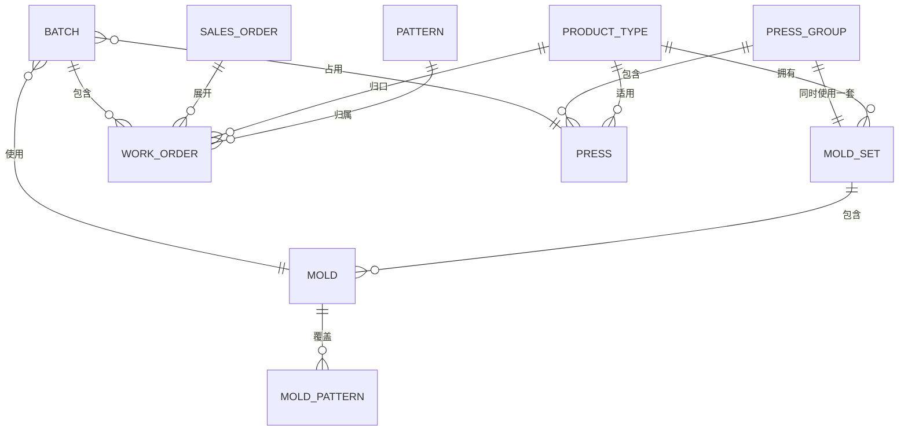
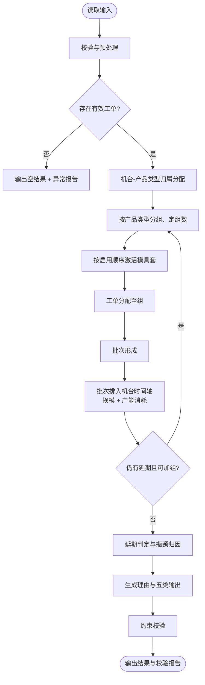

# 热压排程算法设计

> 依据：《热压排程算法说明》（需求说明书）及其主流程图
> 版本：v0.2（设计稿，待评审）
> 定位：确定性规则算法，离线批处理，不依赖历史结果，不做增量重排
>
> v0.2 相对 v0.1 的改动集中在**口径对齐**：§3 输入数据字典按参考实现的实际口径改写
> （含 4 个「引擎不读」字段的用途标注）、§4.3/§4.4 输出字段口径、§14.5 敏感性说明、
> §15 8.5、§19 与 §24.1 的结论前提。逐条依据见《热压排程算法落地计划》§三。
>
> v0.2 内另做过一次**消除自相矛盾**的修订（同属口径对齐，未再升版）：
> §7.2「单位统一换算为基础单位」与 §3.1「`uom` 不换算」冲突，已改为「不换算」；
> §8.1「一机多类型按工作量分配」与 §3.7「`io/` 必须显式报错」冲突，已改为单归属报错；
> §9.1 补 `K(w)` 取哪套模具的两种用法、§9.2 补 `max(1, …)` 下限与 `A < group_size` 的
> 边角情形（R006 判据随之改为同口径）、§13.3 补零生产日分支并订正 `W`/`daily_capacity`
> 的口径说明、§24.2 订正 selftest 的换模次数。
> 逐条依据见《热压排程算法落地计划》§九。

---

## 0. 设计摘要

| 项目 | 结论 |
| --- | --- |
| 算法类型 | 确定性启发式（列表调度 + 优先级匹配），无随机、无 ML |
| 计划粒度 | 生产日，可细分到班次（slot） |
| 核心资源 | 热压机、模具（副）、模具套、生产班次 |
| 核心决策 | 开几组 → 启用哪套模具 → 套内哪副模具 → 哪台机 → 哪个班次 |
| 优化次序 | 交期 > 设备利用率/均衡 > 换模次数 > 可解释与稳定 |
| 计算规模 | 工单 1 万级、机台几十台、产品类型约 30、模具数百副，秒级完成 |
| 可复现 | 相同输入必得相同输出，所有排序均有确定性 tie-break |

---

## 1. 设计目标与原则

1. **交期优先**：先最小化延期订单数，再最小化总延期天数；任何利用率或换模优化都不得以牺牲交期为代价。
2. **约束硬性**：第六章四类约束（时间、资源、工艺、对象）是硬约束，任何一条不满足即结果无效。
3. **全量重算**：每次运行都是一次完整计划，只依赖本次输入，不回读上一次结果。
4. **可解释**：每个决策（机台、模具、批次、时间）都能落到一条规则与一组数据上。
5. **显式失败**：异常必须报告，不静默丢弃、不猜默认值。
6. **确定性**：无随机数；若未来引入随机算法，必须固定种子。

---

## 2. 术语与对象模型

| 术语 | 含义 | 备注 |
| --- | --- | --- |
| 产品类型 | 约 30 个业务大类（三角牌、多米诺骨牌等） | 所有计算的归口维度 |
| 牌型 | 产品类型下的具体形状/花色 | 模具按牌型覆盖，工单必须携带牌型 |
| 模具（副） | 一副物理模具，装在一台热压机上 | 单点/多点；多点一次出多种牌型 |
| 模具套 | 若干副模具的集合，一个产品类型可有多套 | 套数 = 该类型最多同时开动的组数 |
| 组 | 两台热压机为一组，共用一套模具 | 一人操作两台，人员不单独建模 |
| 模数（cycle） | 热压机压一次 | 产能单位「模/班」 |
| 产出配比 | 一副模具一次成型各牌型的产出数量 | 决定工单需要多少模 |
| 班次（shift） | 12 小时一班，日历标明每天 1 或 2 班 | 排程最小时间单位 |
| 换模时间 | 更换模具占用机台的时长 | 以小时配置，折算为消耗模数 |
| 前置偏移 | 热压需在交货日前完成的天数，当前 15 天 | 仅日期差值，不是冷却时间 |
| 批次 | 同一机台、同一模具、同一时段完成的一组工单 | 合并的是现场批次，ERP 工单不合并 |

### 2.1 对象关系



### 2.2 资源层级

```
产品类型
 ├─ 模具套 1 ── 模具 1(优先级1, 多点: X/Y) ── 模具 2(优先级2, 单点: X)
 ├─ 模具套 2 ── 模具 3(优先级1, 多点: X/Y)
 └─ 机台组 1(热压机 1、2) ── 同时绑定一套模具
    机台组 2(热压机 3、4)
```

---

## 3. 输入数据模型

所有输入为结构化表格，字段命名可按双方约定调整；下表为逻辑模型。

> **本节口径以参考实现为准。** 各表下的引注说明该逻辑表在 `prototype/` 里对应的
> 实际结构；标为「引擎不读」的字段是客户会提供、但算法当前不使用，列出用途以免被
> 当成缺陷。完整字段字典（含类型、必填、枚举值、示例行）见
> 《热压排程输入输出字段字典.md》。

### 3.1 热压工单 `work_order`

| 字段 | 类型 | 必填 | 说明 |
| --- | --- | --- | --- |
| work_order_no | string | 是 | 工单号，主键 |
| sales_order_no | string | 是 | 所属销售订单号；批次不得跨销售订单 |
| product_type_code | string | 是 | 产品类型；可由 ERP 大类映射得到 |
| pattern_code | string | 是 | 牌型；用于模具覆盖匹配（说明书未显式列出，但批次合并必需） |
| material_code | string | 否 | 半成品物料编码。**引擎不读**，预留给 A1-b「物料反查牌型」（§18.1） |
| qty | decimal | 是 | 工单数量 |
| uom | string | 是 | 计量单位（张/千张/万张等）。**引擎不做换算**，要求输入已与产出配比同口径 |
| due_date | date | 否 | 客户交期；缺失或早于计划起点时按异常数据报 R010（§7 V03、§15 8.4、§15 8.5） |
| status | enum | 是 | NOT_STARTED / IN_PROGRESS / COMPLETED / CANCELLED |
| remaining_qty | decimal | 否 | 在制工单的剩余数量；未开始= qty；已完成/已取消不参与 |

**预处理规则**

- `COMPLETED`、`CANCELLED`：直接排除，不进入排程。
- `IN_PROGRESS`：排程数量取 `remaining_qty`，为 0 时排除。
- `NOT_STARTED`：排程数量取 `qty`。
- `qty <= 0` 或 `due_date` 缺失：标记异常数据（R010），不排程。
- `uom` **不换算**：当前实现要求输入单位已与产出配比一致（前置条件）。换算表属可选输入，
  是否启用待阶段 1 确认（见 §24.1 第 8 项）。

### 3.2 产品类型 `product_type`

| 字段 | 类型 | 必填 | 说明 |
| --- | --- | --- | --- |
| product_type_code | string | 是 | 主键 |
| product_type_name | string | 是 | 名称 |
| erp_category_codes | string[] | 是 | 对应的 ERP 产品大类编号列表。**引擎不读**，供 `io/` 层做 ERP 大类 → 产品类型映射 |

### 3.3 模具套 `mold_set`

| 字段 | 类型 | 必填 | 说明 |
| --- | --- | --- | --- |
| set_no | string | 是 | 主键 |
| product_type_code | string | 是 | 所属产品类型 |
| set_order | int | 是 | 启用顺序（`SET_ORDER` 策略按此升序启用） |

> **套内副数不是输入字段**，由 `mold` 表按 `set_no` 派生：等于该套下
> `status = AVAILABLE` 且配比有效的模具副数。它决定组内可并行机台数（§5.6、§9.2）。

### 3.4 模具 `mold`

| 字段 | 类型 | 必填 | 说明 |
| --- | --- | --- | --- |
| mold_no | string | 是 | 主键。**同一模具号不得出现在多个套**（§7 V10） |
| set_no | string | 是 | 所属模具套 |
| mold_type | enum | 否 | SINGLE（单点）/ MULTI（多点）。**引擎不读**，仅资料留存：单点/多点由 `mold_pattern` 的牌型行数推出（1 行即单点） |
| priority | int | 是 | 套内使用优先级，数值越小越优先 |
| status | enum | 否 | AVAILABLE / MAINTENANCE，默认 AVAILABLE |

### 3.5 模具-牌型配比 `mold_pattern`

| 字段 | 类型 | 必填 | 说明 |
| --- | --- | --- | --- |
| mold_no | string | 是 | 外键 |
| pattern_code | string | 是 | 牌型 |
| ratio | decimal | 是 | 每模产出数量，> 0 |

> 一副多点模具可有多行；单点模具仅一行。
>
> **落地形态**：这是一张**逻辑表**，参考实现中透视进 `Mold.ratios: dict[牌型 → 配比]`
> （`prototype/domain/models.py`）。`io/` 层负责把多行折叠成该字典；同一
> `(mold_no, pattern_code)` 出现重复行时必须报错，不得静默取一。

### 3.6 热压机 `press`

| 字段 | 类型 | 必填 | 说明 |
| --- | --- | --- | --- |
| press_no | string | 是 | 主键 |
| capacity_per_shift | int | 是 | 每班产能（模/班） |
| status | enum | 否 | AVAILABLE / MAINTENANCE |

### 3.7 机台适用产品类型 `press_product_type`

| 字段 | 类型 | 必填 | 说明 |
| --- | --- | --- | --- |
| press_no | string | 是 | 外键 |
| product_type_code | string | 是 | 可承担的产品类型 |

> **当前只支持「一台机只归属一个产品类型」**（§18.1 的 A2 假设）。参考实现把它建模为
> `Press.product_type_code` 单值，而非多对多表。`io/` 层遇到同一 `press_no` 对应多个
> 产品类型时必须**显式报错**，不得静默取一——否则机台时间轴会被两个类型同时占用。
> A2 若答「会」，改动量见《热压排程结构性假设影响评估.md》§五。

### 3.8 工作日历 `calendar`

| 字段 | 类型 | 必填 | 说明 |
| --- | --- | --- | --- |
| date | date | 是 | 主键 |
| shifts | int | 是 | 当天班次数：0/1/2；0 表示不生产 |
| is_holiday | bool | 是 | 是否节假日 |

> 未覆盖的日期按不生产处理，并输出日历缺失报告（R011）。

### 3.9 规则参数 `params`

| 参数 | 默认 | 说明 |
| --- | --- | --- |
| plan_start | 运行日 | 计划起点 |
| group_size | 2 | 每组的机台数 |
| pre_offset_days | 15 | 前置偏移天数 |
| shift_hours | 12 | 单班时长 |
| changeover_hours | 2 | 换模时长；正式取值待双方确认（§18.2 第 4 项） |
| horizon_months | 3 | 读取工单的月份范围。**引擎不读**，属 `io/` 层选数范围：`io/` 按此决定取哪些月份的工单 |
| allow_cross_sales_order_batch | false | 是否允许批次跨销售订单 |
| backfill_gaps | true | 是否回填空闲时段（§12.6） |
| set_activation_policy | DEMAND_CYCLES_FIRST | 模具套启用策略（§10.1；可选 MAX_MOLDS_FIRST / SET_ORDER / COVERAGE_FIRST） |
| time_limit_seconds | 0 | 全量计算的时间上限（秒），0 表示不限制；超限则输出部分结果并置 `run_meta.truncated = true`（§15 8.10、§20.2） |

---

## 4. 输出数据模型

### 4.1 热压排程结果 `schedule_result`

| 字段 | 说明 |
| --- | --- |
| work_order_no | 工单号 |
| sales_order_no | 销售订单号 |
| product_type_code | 产品类型 |
| pattern_code | 牌型 |
| batch_no | 所属批次 |
| press_no | 分配机台 |
| group_no | 所属机台组 |
| set_no / mold_no | 使用的模具套与模具 |
| plan_qty | 排程数量 |
| cycles | 该工单所需模数 |
| planned_start_date / planned_start_shift | 计划开始 |
| planned_end_date / planned_end_shift | 计划结束（该工单自身完成时点） |
| delayed | 是否延期 |
| delay_days | 延期天数 |
| reason_code | 最严重的原因码（§14.0 严重度最高者） |
| reason_codes | 完整原因码列表（写给人看，含信息级） |
| bottleneck_resource | 延期时的瓶颈归因文本（§13.3） |

### 4.2 批次划分结果 `batch_result`

| 字段 | 说明 |
| --- | --- |
| batch_no | 批次号 |
| sales_order_no | 所属销售订单 |
| group_no | 所属机台组 |
| set_no / mold_no / press_no | 资源 |
| patterns | 批次覆盖的牌型集合 |
| work_order_nos | 工单清单 |
| cycles | 批次总模数 = 各工单模数最大值 |
| start_date / start_shift | 开始 |
| end_date / end_shift | 结束 |
| output_qty | 各牌型产出量（含超产，按牌型编码） |
| surplus | 各牌型超产量（按牌型编码） |
| changeover_cycles | 本次换模消耗 |

### 4.3 订单齐套与延期 `order_delivery`

| 字段 | 说明 |
| --- | --- |
| sales_order_no | 销售订单号 |
| due_date | 应交日期 |
| expected_finish_date | 预计完成日期（该订单最晚工单完成日） |
| delayed / delay_days | 延期标记与天数 |
| bottleneck_resource | 瓶颈机台/模具/日历 |
| reason_code / reason_text | 具体原因。`reason_text` 取**本订单内延期最重工单**的归因文本（§13.3），订单不延期时为空串 |

### 4.4 可释放数量 `release_plan`

| 字段 | 说明 |
| --- | --- |
| batch_no | 批次 |
| pattern_code | 牌型 |
| release_qty | 可释放数量 = **批次模数 K(B)** × 该牌型配比，与 `batch_result.output_qty` 同口径（含超产）。**不得用该工单自身的模数 K(w)**：多点模具合批时 `K(B) = max K(w) > K(w)`，用 K(w) 会让超产在释放计划里凭空消失，与同一份输出的 `output_qty`、`surplus` 自相矛盾 |
| release_date / release_shift | 该牌型完成时点，取**批次结束槽位**（批次所有牌型在同一次整模生产中同时产出） |
| downstream_order_no | 下游工单（若提供） |

### 4.5 排程理由 `schedule_reason`

| 字段 | 说明 |
| --- | --- |
| work_order_no | 工单 |
| machine_reason | 为什么选这台机（适用类型、负荷最轻、同组） |
| time_reason | 时间窗口受什么约束（交期、前置偏移、班次、换模） |
| batch_reason | 为什么与这些工单同批（同销售订单、模具覆盖、配比） |
| mold_reason | 为什么用这套/这副模具（优先级、占用、套数上限） |
| sensitivity_note | 关键输入变化时的影响（可选，见 §14.5） |

---

## 5. 核心计算定义

### 5.1 工单模数

```
K(w) = ceil(qty(w) / ratio(mold, pattern(w)))
```

`ratio` 为该模具对该牌型的每模产出。除不尽时向上取整，因此必然存在超产（尾数），需在批次输出中报告。

### 5.2 批次模数

一个多点模具批次包含每个牌型最多一张工单：

```
K(B) = max over w in B of K(w)
```

批次运行 `K(B)` 模；某工单自身在 `K(w)` 模后即完成，其余时间产出该牌型的超产。

### 5.3 班次与产能

- 全局时间轴由「生产槽位」组成：`slot_index` 按日期、班次升序编号，跳过非生产日。
- 每个槽位对每台机台提供 `capacity_per_shift` 模产能。
- 任务占用：从起始槽位开始消耗产能，跨槽位连续占用。

```
consume(usage, start_slot, cycles, C):
    s = start_slot
    while cycles > 0:
        rem = C - usage.get(s, 0)
        take = min(rem, cycles)
        usage[s] += take
        cycles -= take
        if cycles > 0: s += 1
    return s        # 结束槽位
```

### 5.4 换模折算

换模以小时配置，按班产能折算为消耗模数：

```
changeover_cycles(C) = ceil(changeover_hours / shift_hours * C)
```

换模消耗发生在机台上、生产开始之前；若跨槽位则顺延。模具在换模开始时装上，换模期间不产出。

### 5.5 目标完成日与延期

```
target_finish(w) = max(plan_start, due_date(w) - pre_offset_days)
delay_days(w)    = max(0, finish_date(w) - due_date(w))   # 自然日
```

- 前置偏移只用于规划时间窗口，不改变「是否延期」的判定基准（基准是客户交期）。
- 若 `target_finish` 已早于计划起点，说明该工单已处于风险区，直接按最早可行时间安排。

### 5.6 组与有效并行度

```
组内有效机台数 p_g = min(group_size, 该组模具套的模具副数)
组日产能         cap_g = p_g × C_g × 当天班次数
```

> 若一套模具只有 1 副，则组内第 2 台机无法同时开工，有效并行度降为 1。这是「同一副模具同一时刻只能装在一台机台上」的直接结果。

---

## 6. 算法总流程



算法分为七个阶段：

| 阶段 | 内容 | 关键产物 |
| --- | --- | --- |
| P0 | 校验与预处理 | 有效工单集、异常清单 |
| P1 | 机台归属与分组 | 机台→产品类型、机台组 |
| P2 | 组数决策 | 每类型开动组数 g |
| P3 | 模具套启用与工单分配 | 组↔模具套、工单→组 |
| P4 | 批次形成 | 批次、候选模具、模数 |
| P5 | 时间排布 | 机台/模具时间轴、起止槽位 |
| P6 | 延期、归因、输出 | 五类结果表、理由 |

---

## 7. P0 校验与预处理

### 7.1 校验项

| 编号 | 校验 | 处理 |
| --- | --- | --- |
| V01 | 工单号重复 | 保留首条，其余报异常 |
| V02 | 数量 ≤ 0 | 异常数据 R010，不排程 |
| V03 | 交期缺失或早于计划起点 | 异常数据 R010；早于计划起点仍尝试排程并标记高风险 |
| V04 | 产品类型无法映射 | 异常数据 R010 |
| V05 | 牌型缺失 | 异常数据 R010（无法匹配模具） |
| V06 | 机台无适用产品类型 | 该机台不参与分配 |
| V07 | 模具配比 ≤ 0 或缺失 | 该模具不可用，报异常 |
| V08 | 日历缺失日期 | 按不生产处理，输出缺失报告 R011 |
| V09 | 模具套/模具引用不存在 | 该模具不可用，报异常 |
| V10 | 模具号跨套重复 | 报异常 R010；**不擅自决定归属**，仍输出已排部分结果（该输入下结果可能违反 C02，异常表已指明原因） |

### 7.2 预处理

- 排除 `COMPLETED` / `CANCELLED`。
- `IN_PROGRESS` 取 `remaining_qty`。
- 数量单位**不换算**：要求输入已与产出配比同口径，这是前置条件而非预处理步骤（§3.1）。
  引擎不读 `uom` 字段；换算表属可选输入，是否启用待阶段 1 确认（§24.1 第 8 项）。
- 工单按 `(target_finish, due_date, sales_order_no, work_order_no)` 排序，形成全局优先级序列。

> 该序列是后续所有匹配与调度的默认顺序，也是确定性的基础。

---

## 8. P1 机台归属与分组

### 8.1 机台→产品类型

说明书表述为「一台热压机被指定适用某个产品类型」。参考实现按**单归属**建模：机台资料里的
适用类型是 `Press.product_type_code` **单值**（§3.7），一台机在计划期内只服务一个产品类型。

1. 机台只列出一个适用类型时，直接归属该类型。
2. 列出多个类型时**不是**「挑一个工作量最大的」——这是输入错误。`io/` 层必须显式报错
   （§3.7），不得静默取一：机台时间轴会被两个类型同时占用，结果违反 C04。参考实现读的是
   单值字段，因此这一情形不会进入引擎。
3. 适用类型未定义（V06）的机台不参与排程，报 R009。

> 这是设计假设 A2（见 §18）。若现场确实存在「一机多类型、按时段切换」，需要扩展为全局时间轴共享，方案见 §18.3。

### 8.2 组内配对

对每个产品类型：

```
presses = 归属该类型的机台，按 press_no 升序
groups  = 按 group_size 顺序两两配对
          余数单独成组（组内机台数 1）
```

配对结果在本次运行内固定，不随排程变化。

---

## 9. P2 组数决策

### 9.1 工作量估算

按销售订单分别估算，避免高估多点模具的合并收益：

```
对每个销售订单 so：
    W_so = max over pattern p in so of  Σ K(w) for w in so with pattern p
W = Σ W_so
```

含义：多点模具一次可同时推进多个牌型，理论上的机台模数下界由「单牌型总模数」的最大值决定。

> **`K(w)` 用哪副模具的配比，两处用法不同，不可互换。**
>
> | 用途 | 取的模具 | 为什么 |
> | --- | --- | --- |
> | §9.3 的 `g_needed` | **§10.1 排序首位那套**的模具 | 保守下界：宁可低估组数，再由 §9.4 向上迭代修正 |
> | §13.3 的 `W` | 该类型**全部套**的模具并集 | 只取一套并不构成下界，会让「日历够不够」判错 |
>
> 两者都取「覆盖该牌型的模具中的**最高配比**」（配比越高模数越小，即最乐观的下界）。

### 9.2 可用组数上限

```
max_groups = max(1, min(可用模具套数 S, floor(适用机台数 A / group_size)))
```

> `max(1, …)` 兜住的是 `A < group_size` 的情形：§8.2 规定「余数单独成组」，因此 1 台机配
> `group_size = 2` 时仍可开 1 组（组内 1 台机，有效并行度按 §5.6 取 1）。去掉这个下限，
> 公式会给 0，与 §8.2 直接冲突。
>
> 该下限同时要求 §13.3 的 R006 判据同口径：`floor(A/group_size)` 在 `A < group_size` 时
> 为 0，直接拿它比较会让 R006 永不命中，归因落到兜底行、输出与事实相反的「未开满」
> （该类型其实正卡在组数上限上）。故 §13.3 的 `press_cap` 同样取 `max(1, floor(A/group_size))`。

### 9.3 需求组数

```
slots    = 该类型在 plan_start 到最晚 target_finish 之间的槽位数（生产日 × 班次）
parallel = min(组内机台数, §10.1 排序首位那套的可用模具副数)
cap      = min over 该类型适用机台 of 每班产能          # 取最慢机台，保守下界
cap_g    = parallel × cap × slots
g_needed = ceil(W / cap_g)
g        = clamp(g_needed, 1, max_groups)
```

> `cap` 取最慢机台、`parallel` 取实际启用套的副数，都是**保守下界**：宁可低估组数，
> 由 §9.4 向上迭代修正；高估则会从一个过大的组数起步、失去修正方向。
> `slots` 直接取槽位数而非「平均每日班次 × H」，是为了让下游全部走整数运算（§16.1）。

### 9.4 反馈修正

初值可能偏小，采用确定性迭代：

```
for g in g_needed .. max_groups:
    用 g 组排程
    if 该类型无延期: break
    if g == max_groups: break
```

每次迭代完整重排该类型，保证结果可复现。迭代次数上界为 `max_groups - g_needed + 1`，通常不超过 3。

> 迭代只调整组数，不改变工单顺序与 tie-break，因此相同输入仍得到相同输出。

---

## 10. P3 模具套启用与工单分配

### 10.1 套启用策略

第 i 组绑定第 i 套，因此「启用哪几套」等价于「按什么顺序取前 g 套」。

默认 `DEMAND_CYCLES_FIRST`：按「用该套排完本类型待排工单所需的机台模数」升序。

```
对每套 s，给定本次待排工单 orders：
    covered(s)  = {w ∈ orders : s 中有模具覆盖 w.pattern_code}
    uncovered(s)= |orders \ covered(s)|
    total(s)    = Σ_{w ∈ covered(s)} cycles_for(w.plan_qty, s 中覆盖该牌型的最高配比)
    parallel(s) = min(组内机台数, 套内可用副数)

排序键 = (uncovered, total / parallel, -副数, set_order, set_no)   升序
```

两个维度按字典序比较，都越小越该优先启用。**未覆盖工单数排在实需模数之前**：
§10.2 的按需补套受组数上限约束，套数一旦用尽就补不了，此时本套覆盖不到的工单
会直接落 R008；若把覆盖不到的工单按「别的套会承接」来计价，窄覆盖的高配比套
会被高估——实测在只能开 1 组的类型上，这会选中一个让半数工单排不了的套。

**为什么要看配比**：模数 = `ceil(数量 / 配比)`，配比直接决定工作量。只按副数排序
会选中副数多但配比差的套。实测某产品类型：`MAX_MOLDS_FIRST` 选中 4 副、配比
40/60/80 的套，357 张工单无一用上另一套里配比 120 的模具，机台实跑 7296 模，
而按最优配比只需 3163 模——2.31 倍无谓机时，且因该套并不缺牌型覆盖，
§10.2 的补套不会被触发。

**为什么要除以有效并行度**：§5.6 的有效并行度是 `min(组内机台数, 套内模具副数)`，
一副模具同一时刻只能装一台机，单副模具的套实际只有 1 台机在跑，不折算会高估其产能。

实测对比（1 万工单基准，5 个固定种子合计，延期工单 / 总延期天数）：

| 排序键 | 延期工单 | 总延期天数 | 逐种子变化 | 变差种子 |
| --- | --- | --- | --- | --- |
| `MAX_MOLDS_FIRST` | 4376 | 46692 | — | 0/5 |
| 仅按套内最高配比降序 | 3991 | 44785 | −16.3% −12.8% −1.4% −27.8% **+8.9%** | **1/5** |
| **`DEMAND_CYCLES_FIRST`** | **2889** | **23216** | −35.3% −28.8% −22.3% −53.5% −35.7% | **0/5** |

> 仅按「套内最高配比」排序不稳健：它看的是套内**所有**配比的最大值，可能选中配比
> 高但牌型对不上的套（上表第 4 个种子的某类型即如此，延期工单由 0 变 41）。按
> 「本次待排工单的实需模数」排序则不会，因为对不上的牌型根本不进 covered。

可选策略（配置项，供双方确认后切换）：

| 策略 | 规则 | 适用 |
| --- | --- | --- |
| DEMAND_CYCLES_FIRST | 见上方公式 | 默认，兼顾牌型覆盖与配比产能 |
| MAX_MOLDS_FIRST | 按套内可用模具副数降序，同数时按 set_order | 各套配比接近、只比并行度时 |
| SET_ORDER | 按 `set_order` 升序 | 现场对套序号有明确先后要求时 |
| COVERAGE_FIRST | 按可覆盖牌型数降序，再按副数降序 | 牌型分布不均时 |

> 策略名与其排序键严格对应；传入未知策略会显式报错，不会静默退回某个默认排序。
> 需求说明书 §5.1 要求「启用哪一套由算法判断，而不是由某个固定字段直接指定」，
> 因此默认不是纯 `set_order`。

> **`DEMAND_CYCLES_FIRST` 与 `MAX_MOLDS_FIRST` 的优劣取决于各套配比的离散度，
> 不是单向占优。** 5 个固定种子合计（1 万工单基准，见 `tests/sensitivity.py`）：
>
> | 同一类型内各套配比 | `MAX_MOLDS_FIRST` | `DEMAND_CYCLES_FIRST` |
> | --- | --- | --- |
> | 窄 80/85/90（±6%） | **175 单 / 585 天** | 257 单 / 1916 天 |
> | 中 60/80/100（±25%） | 1136 / 5685 | **656 / 2545** |
> | 宽 40/60/80/120（3 倍） | 4376 / 46692 | **2889 / 23216** |
>
> 交叉点大致在 ±25%。配比接近时配比项近似噪声，而副数多的套能提供更多的模具争用
> 回旋余地（`place_batch` 的候选更多），后者更重要，因此反而是按副数排序更稳。
> 配比完全一致（如 80/80/80）时两者**严格等价**——评分相同时回落到
> `(-副数, set_order, set_no)`，即 `MAX_MOLDS_FIRST`。
>
> 因此默认值的选择**必须等正式模具清单**（§18.2 第 1 项）确定离散度后再定；
> 当前默认 `DEMAND_CYCLES_FIRST` 是在「宽」区间下选的，属待复测状态。
> 可考虑后续加一条「离散度低于阈值时回落到按副数排序」的自适应规则，
> 使其在两端都稳，但该阈值同样需要真实数据标定。

### 10.2 工单→组分配

目标：让各组负荷均衡，同时保证该组的模具套能覆盖工单牌型。

**第一步：按需补齐覆盖**（§5.1「一套内的模具用尽后，再回到第一级启用下一套」）

```
needed = 待排工单的牌型集合
for 每套未启用的套（按 §10.1 策略顺序）:
    if needed 已被已启用套完全覆盖: break
    if 该套覆盖不到 needed 中的任何牌型: continue
    if 组数已达 max_groups 或机台不足以再成一组: break
    启用该套并新建一组
```

**第二步：逐单分配**

```
for w in 全局排序序列:
    candidates = 已启用且其模具套中存在模具覆盖 w.pattern 的组
    if candidates 为空:
        w 标记 R008 无法排产-无适配模具      # 第一步已尽量补齐，仍无解
        continue
    选择 candidates 中「(已分配模数 + K(w)) / 该组有效并行度」最小者
    同量时选组号最小者
    分配给该组，组负荷 += K(w)
```

- **为什么要除以有效并行度**：一副模具同一时刻只能装在一台机台上，因此套内只有
  1 副模具的组实际只能开 1 台机。若按原始模数比较负荷，模具少的组会占满工单却
  只开一台机，造成产能浪费。
- 比较用**有理数**（`Fraction`）而非浮点除法，保证平局判定精确、结果可复现（§16.1）。
- 分配完成后，组内工单保持全局排序的相对顺序。

---

## 11. P4 批次形成

### 11.1 批次约束

1. 同一批次必须在**同一销售订单**内（默认，可配置）。
2. 同一批次内每个牌型最多一张工单。
3. 批次内所有牌型必须能被**同一副模具**覆盖。
4. 以完整模具组织生产，不拆分 ERP 工单。
5. 单点模具批次只含一张工单。

### 11.2 批次算法

```
for each group g:
    orders = 分配给 g 的工单，保持全局排序
    open_batches = []          # 同销售订单、牌型不冲突、可被某副模具覆盖
    for w in orders:
        target = None
        for b in open_batches:          # 首次适配：取第一个兼容的未关闭批次
            if b.sales_order_no != w.sales_order_no: continue
            if w.pattern in b.patterns: continue
            if not exists_mold_covering(b.patterns ∪ {w.pattern}, g.set): continue
            target = b
            break
        if target is None:
            b = new_batch(sales_order=w.sales_order_no, patterns={w.pattern})
            open_batches.append(b)
            b.add(w)
        else:
            target.add(w)
```

> 合并时用**首次适配**，而不是挑选「覆盖模具优先级最小」的批次：批次在形成阶段并不最终
> 决定用哪副模具（§12.3 在落位时按「开始槽位最早 → 模具 priority」重新选择），因此
> 形成阶段的优先级打分并不对应最终结果，只会增加复杂度。首次适配确定且足够。

### 11.3 批次候选模具

```
candidate_molds(B) = { m in g.set.molds |
                       m.status == AVAILABLE 且
                       B.patterns ⊆ m.patterns }
```

若为空（理论上被 11.2 的覆盖检查排除），该批次报 R008。

### 11.4 模数与超产

```
K(B) = max(K(w) for w in B)
for w in B:
    produced(w) = K(B) × ratio(mold, w.pattern)
    surplus(w)  = produced(w) - qty(w)
```

- `surplus > 0` 时在 `batch_result` 中报告，并在 `schedule_result` 标记 R012（尾数/超产提示）。
- 超产不是错误，是「完整模具生产」的必然结果；但尾数异常交由人工确认，不得跨销售订单合并消化。

### 11.5 批次排序

批次按以下键升序排入时间轴：

```
(min target_finish in B, min due_date in B, sales_order_no, min work_order_no)
```

该排序体现「交期优先」。

### 11.6 批号生成

```
batch_no = "B" + 全局序号(5 位，从 1 起)
```

三条硬性要求：

1. **全局唯一**：整个结果集中任意两个批次的 `batch_no` 不得相同。
   编号计数必须是**单一来源**，不能「内层按已创建的批次推进、外层按已落位的批次推进」
   两套计数并存——一旦有批次排不进时间轴，两套计数就会错位，
   后续产品类型会复用已用过的号（该校验由 §17 的 C15 兜底）。
2. **确定性**：相同输入必得相同编号，不依赖遍历顺序或哈希。
3. **连续**：编号在**落位成功时**才分配，因此
   - 未能落进时间轴（产能不足）的批次不占号——它不进入 `batch_result`，
     其工单由 R007 异常报告；
   - 组数迭代（§9.4）中被放弃的尝试，其占用的编号要**回收**，否则编号会从
     `B00128` 之类的中间位置起步，输出里出现大片无意义的空号。
     回收时须注意：**只有「还会再试一次」时才回收**——最后一次尝试的结果是要
     采纳的，回收它的编号会让下一个产品类型撞号。

   于是 `batch_result` 中的编号恰好是 `B00001 … B00NNN`（NNN = 批次数）。

> 编号仅作引用键，**不承载任何语义**（既不代表先后，也不代表优先级）。
> 批次的先后由 §11.5 的排序键决定，不由编号决定。

---

## 12. P5 时间排布

### 12.1 资源时间轴

| 资源 | 记录内容 | 约束 |
| --- | --- | --- |
| 热压机 | 每槽位已用模数、当前所装模具 | 同时只执行一项任务 |
| 模具（副） | 占用槽位区间 | 同时只能装在一台机台上 |
| 模具套 | 绑定的组 | 同时只被一组使用 |
| 组 | 固定机台集合 | 组内机台共享该套模具 |

### 12.2 候选评估

对批次 B，候选为「组内机台 × 覆盖 B 牌型的模具」。机台时间轴维护
`used[]`（每槽位已用模数）与 `intervals`（已提交区间的起止、模具、换模消耗）：

```
evaluate(press, mold, K):
    start = press.first_free        # 回填时；不回填时为 press.cursor
    while start < 日历末尾:
        if press.used[start] != 0 or mold_busy[start]:
            start += 1; continue
        run_end = 从 start 起的连续空闲区间终点      # 机台空 且 模具空
        prev_mold = press.mold_before(start)         # 紧邻 start 之前那一段所用模具
        chg = changeover_cycles if prev_mold 存在且 != mold else 0
        slots = ceil((chg + K) / 每班产能)
        if run_end - start + 1 >= slots:
            end = start + slots - 1
            if 插入不会破坏后继区间的换模记账:
                return (start, end, chg)
        start = run_end + 1        # 该区间放不下，跳到其后
    return 不可排
```

评估阶段只读，不修改时间轴；选定后再提交。

> 这里的 `mold_before(start)` 是回填能成立的关键：判定某处该不该换模时，查的是
> **该处之前那一段**用的模具，而不是「最近一次提交的模具」——回填会让落位顺序
> 与时间顺序不一致，后者会得出错误结论。

> 「插入不会破坏后继区间的换模记账」见 §12.6 的插入守卫。

### 12.3 选择规则（交期优先 + 优先级）

```
for press in 组内机台（按机台号升序）:
    for mold in 套内覆盖 B 牌型的模具（按 priority 升序）:
        if 存在可行落位（§12.2 的 evaluate）:
            候选 = (开始槽位, 模具 priority 序号, 机台号)
选择 候选 中键最小者
若所选模具不是覆盖该批次的最高优先级模具:
    记录 R003「改用次优先模具」
```

三键依次为：**开始槽位最早 → 模具 priority 最小 → 机台号最小**。

含义：

- 组内空闲机台立刻取用当前可用的最高优先级模具，使组内多副模具并行开工，
  这正是 §5.6「有效并行度 = min(组内机台数, 套内模具副数)」得以成立的前提；
- 最高优先级模具被占用时，改用套内次优先模具以保持机台不空转，记录 R003；
- 任何情况下不为等待优先级模具而主动空转（避免无谓延期）。

> **为什么第一键不是「优先级」而是「开始时间」**：若以优先级为第一键，一组内的
> 两台机都会去抢同一副最高优先级模具，结果是第二台机宁可排队等待也不用套内第二副
> 模具，组内并行度退化为 1，与 §5.6 直接冲突。需求说明书 §5.1 的表述是「先用优先级
> 最高的模具覆盖尽可能多的工单，覆盖不完的部分再依次使用同一套内的后续模具」，
> 以开始时间优先恰好实现了这一点。

> 注意：`target_finish` 只是规划窗口（交期 − 前置偏移），晚于它记为「超出前置窗口」预警；
> 真正的「是否延期」在 §13 按客户交期判定，两者不可混淆。

> **实测：前置偏移天数的取值不影响排程结果与延期指标**（`tests/sensitivity.py` 扫
> 0/7/15/20/30/45 天，延期工单、总延期天数、换模次数完全相同，只有 R001/R002 的
> 分布变化）。原因是排程从 `plan_start` 起贪心取最早可开工槽位，各工单的偏移是均匀的、
> 相对顺序不变，`target_finish` 只进入排序键与预警判定，从不构成约束。
>
> 因此需求说明书 §5「热压计划需要在交货日期之前完成，提前的天数由配置项给出」的**口径
> 需与客户确认**：若现场要求它是**硬约束**（必须留出余量，排不到即报风险），当前实现
> 只预警不约束，需改；若只是内部规划目标，则当前实现正确。这一项不必等模具数据即可确认。

### 12.4 时间推进与跨日

- 槽位按日历生成，非生产日不产生槽位。
- 单张工单模数超过单班产能时，同一机台连续跨槽位/跨日执行，不拆分（R004）。
- 同一批次内的工单，其完成时点按各自 `K(w)` 计算，早于批次结束：
  ```
  finish_slot(w) = advance(batch_start, K(w))
  ```

### 12.5 换模判定

- 机台当前模具与目标模具不同 → 计一次换模，消耗 `changeover_cycles`。
- 机台从未装过模具（计划期内首次排产）不计换模：首次装模不是「更换」。
- 同一批次连续生产不换模。
- 机台空闲但模具未拆下，后续用同一模具不换模。
- 换模消耗记入批次输出，供校验器核对（C08）。

### 12.6 回填空闲时段

机台时间轴以**已提交区间序列 + 每槽位已用模数**表示，而不是一个单调游标。
`backfill_gaps = true`（默认）时：

- 从「首个仍有剩余产能的槽位」起，寻找**首个足够长的连续空闲区间**
  （区间内每槽位机台未占用、模具也未占用），把批次连同其换模一起放入；
- 因此机台在等待模具期间留下的空档，可以被后续批次使用；
- 关闭该选项时退化为从追加游标起单调追加，结果更简单但利用率略低。

**换模按紧邻前驱区间判定，与落位先后无关。** 这是回填能成立的前提：区间
`(start, end, mold_no, changeover)` 记录了这一段起始处的换模消耗，判定某处该不该
换模时，查的是该处之前那一段用的模具，而不是「最近一次提交的模具」。

> **插入守卫**：把新批次插到已提交区间 P 与 S 之间时，S 的换模需求可能由
> 「同模不计」变成「异模计一次」，而该值已经写死在 S 的记录里、无法回改。
> 因此这种插入必须放弃，换一个位置。少了这道守卫，回填会静默破坏 C08。

> 注意：由于贪心规则总是选择「开始槽位最早」的机台与模具，机台时间轴上很少出现
> 空隙，因此回填在多数数据上与单调追加等价；它的价值体现在模具争用导致某台机
> 被迫等待、而其前方留有足够空档的场景。

---

## 13. P6 延期判定与瓶颈归因

### 13.1 工单级

```
delayed(w)   = finish_date(w) > due_date(w)
delay_days(w)= max(0, finish_date(w) - due_date(w))
```

### 13.2 订单级

```
expected_finish(so) = max finish_date(w) for w in so
delayed(so)         = expected_finish(so) > due_date(so)
delay_days(so)      = max(0, expected_finish(so) - due_date(so))
```

### 13.3 瓶颈归因

按以下顺序判定，取首个命中项：

| 条件 | 瓶颈 | 代码 |
| --- | --- | --- |
| 该牌型无任何模具覆盖 | 模具缺失 | R008 |
| 该产品类型无适用机台 | 机台缺失 | R009 |
| `H == 0` 且 `W > 0`（窗口内没有任何生产日） | 日历产能不足 | R007 |
| `ceil(W / daily_capacity) > H` | 日历产能不足 | R007 |
| `g == max_groups` 且 `max_groups == S` | 模具套数不足 | R005 |
| `g == max_groups` 且 `max_groups == max(1, floor(A/group_size))` | 设备数量不足 | R006 |
| 其他（未开满组数上限） | 受排程顺序限制 | R005 |

其中 `W` 为该类型**全部套**的模具下算出的总模数（§9.1 的口径说明），`H` 为窗口内生产日数，
`daily_capacity` 为该类型**全部已启用套**的日产能合计：

```
daily_capacity = (Σ_g min(组 g 机台数, 套 g 可用副数)) × 最慢机台每班产能 × 窗口槽位数 / H
```

> **`H == 0` 必须单列一行。** 上式的 `daily_capacity` 分母是 `H`，`H == 0` 时按定义取 0，
> 于是 `ceil(W / daily_capacity)` 无定义；若不单列，这一情形会穿过日历判定落到资源分支，
> 报成「模具套数不足」——而加模具对「窗口内一个生产日都没有」毫无帮助。
>
> **本表的 `W` 与 `daily_capacity` 都不是 §9.3 的取值。** §9.3 算 `g_needed` 时 `W` 只取
> 排序首位那套的模具、`cap_g` 是**单组**在窗口内的总产能；本表取全部套的并集与全部已启用套
> 的合计。前者是保守下界（供迭代修正），后者是实际能力（供诊断），混用会让归因指向错误瓶颈。

> **日历判定排在资源之前**：生产日或班次不够不是加机台、加模具能解决的，
> 先报出来才有指向性；反之若日历够用而组数已开满，那才是资源数量的问题。

> **资源两条用「已开满组数上限」作判据，而不是 `g_needed > max_groups`。**
> `g_needed` 是为 §9.4 组数迭代算的下界估算（偏乐观），拿它当诊断判据会把
> 「已开满、再加一组确实能缓解」的延期误判成非资源原因——实测在只能开 1 组的
> 类型上，这样会让全部延期落到兜底行，且文本把「机台数封顶」说成「模具产能限制」。
> §9.4 只在上一组数仍有延期时才加组，因此走到「开满且仍延期」即说明组数就是限制。
> 另外 `g_needed` 若先截断到 `max_groups` 再比较，两条「不足」永远不可能命中。

> 兜底行在正常输入下不可达：只要存在延期，§9.4 的组数迭代就会把 `g` 加到 `max_groups`，
> 而 `max_groups = max(1, min(S, floor(A/group_size)))` 必等于 `S` 或
> `max(1, floor(A/group_size))` 之一：`A ≥ group_size` 时它就是 `min(S, floor(A/group_size))`，
> `A < group_size` 时它等于后者（1）。因此前两条之一必然命中。保留它作为防御性分支。

> 前两行（R008 模具缺失、R009 机台缺失）不走本归因函数：这类工单根本不会被排程，
> 因此没有 `schedule_result` 记录可写，它们只出现在 `exceptions` 表中。

归因结果同时写入工单（`schedule_result.bottleneck_resource`）、
订单（`order_delivery.bottleneck_resource`）与批次输出。

### 13.4 原因描述

必须具体到环节，例如：

- 「产品类型 P03 仅有 2 套模具，最多开动 2 组，需求需 3 组，模具套数不足」
- 「热压机 7# 不适用产品类型 P05，该类型可用机台为 0」
- 「2026-11-03 至 2026-11-05 日历缺失，按不生产处理，可用班次减少 5」

禁止输出「产能不足」这类笼统描述。

---

## 14. 排程理由生成

每张工单生成四段结构化理由 + 可选敏感性说明。

### 14.0 原因码

| 代码 | 含义 | 触发点 | 严重度 |
| --- | --- | --- | --- |
| R001 | 正常排入，满足前置窗口 | P5 | 信息 |
| R002 | 超出前置窗口（仍可能按期） | P5 §12.3 | 预警 |
| R003 | 改用次优先模具以保交期 | P5 §12.3 | 信息 |
| R004 | 单工单超单班产能，跨日连续生产 | P5 §12.4 | 信息 |
| R005 | 模具套数不足，或未开满组数上限下的排程顺序限制 | P6 §13.3 | 瓶颈 |
| R006 | 设备数量不足 | P6 §13.3 | 瓶颈 |
| R007 | 日历生产日/班次不足 | P6 §13.3 | 瓶颈 |
| R008 | 无适配模具，无法排产 | P3/P4 | 异常 |
| R009 | 无适配机台，无法排产 | P1/P3 | 异常 |
| R010 | 输入数据异常（数量/交期/类型/牌型） | P0 | 异常 |
| R011 | 日历缺失，按不生产处理 | P0/P5 | 异常 |
| R012 | 尾数超产，需人工确认 | P4 §11.4 | 预警 |

> 一张工单可同时带多个原因码，`schedule_result.reason_code` 取其中最严重者，
> 完整列表写入 `schedule_reason`。严重度顺序：异常 > 瓶颈 > 预警 > 信息。

### 14.1 机台理由

```
选机依据 = 适用类型匹配 + 同组绑定 + 组内最早可用
文本示例：本工单属于产品类型 P03，可用机台为 3#、4#（同属 2 组）；
          排入时 3# 早于 4# 空闲 1 个班次，故分配 3#。
```

### 14.2 时间理由

```
文本示例：客户交期 2026-12-20，前置偏移 15 天，目标完成日 2026-12-05；
          工单 50 模，3# 每班 20 模，需 3 个班次；2 组当前可用槽位为
          11-18 第 2 班，故计划 11-18 第 2 班至 11-19 第 2 班。
```

### 14.3 批次理由

```
文本示例：与工单 WO-1023 同属销售订单 SO-88，牌型 X/Y 由模具 M1 同时产出
          （配比 2:2），合并为批次 B-0007；批次 50 模，其中本工单 38 模完成，
          剩余 12 模为牌型 Y 的超产。
```

### 14.4 模具理由

```
文本示例：产品类型 P03 共 2 套模具，本次启用第 1 套；M1 优先级 1，
          覆盖 X/Y，满足交期，故优先使用；未启用第 2 套，因单套产能已满足。
```

### 14.5 敏感性说明（可选）

该说明分两层，**默认只出第一层**：

**第一层（默认开启，不做重跑）**——只陈述算式与当前取值，不做方向性因果推断：

- 本工单延期天数、实际完成日、交期；
- 若需求组数超过当前上限，给出「需求 `groups_needed` 组 / 上限 `max_groups` 组
  （`mold_set_count` 套模具 / `press_count` 台机台）」；
- 前置偏移的**当前取值**与它算出的目标完成日，并注明算式
  `目标完成日 = 交期 − 前置偏移`，早于计划起点时取计划起点。

**不得**写成「前置偏移减少 1 天 → 预计提前 N 天」这类方向性表述。按上式，**减少**前置偏移
只会把目标完成日**推后**；且当交期落在计划起点附近时目标完成日被钳到计划起点，取值变化
根本不产生任何影响。方向性的因果只能由第二层给出。

**第二层（可选，默认关闭）**——以修改后的参数重跑一次，仅比较该工单完成日，输出差值：

- 增加 1 套模具 → 完成日变化 N 天；
- 增加 1 台机台 → 完成日变化 N 天；
- 前置偏移 ±k 天 → 完成日变化 N 天。

默认关闭以控制运行时间；现场要求「加一套模具能提前几天」这类结论时才开启
（见《热压排程算法落地计划》阶段 3）。

---

## 15. 边界情况处理矩阵

| 说明书条款 | 场景 | 算法行为 | 输出 |
| --- | --- | --- | --- |
| 8.1 | 产品类型无任何可用模具 | 相关工单不排程，标记异常 | R008 + 原因 |
| 8.2 | 工单无适配机台 | 标记异常 | R009 + 原因 |
| 8.3 | 数量 ≤ 0 | 标记异常数据，不排程 | R010 |
| 8.4 | 交期缺失 | 标记异常数据，不排程 | R010 |
| 8.5 | 交期早于当前日期 | 报 R010（§7 V03 的要求），**仍按最早可行时间排程**（不因异常而跳过）；延期与瓶颈码由 §13.3 归因给出 | R010 + R005/R006/R007 之一 |
| 8.6 | 产品类型无法映射 | 标记异常数据 | R010 |
| 8.7 | 日历缺失日期 | 按不生产处理 | R011 + 缺失清单 |
| 8.8 | 输入为空 | 输出空表，正常结束 | 空结果 |
| 8.9 | 尾数无法被批次覆盖 | 报告超产量，交人工 | R012 + 超产量（**当前进 `reason_codes`，未进 `exceptions` 表，见下注**） |
| 8.10 | 输入规模超预期 | 完成计算并输出性能说明；若超时上限，输出部分结果与说明 | 性能报告 |

**关于 8.5 为什么没有独立的「高风险」标记**：原表写作「标记高风险延期 → R005/R006」，
与 §7 V03（要求报 R010）和 §13.3 的实际归因分支（日历 → 资源 → 兜底）三处互相冲突。
现在统一为：**异常由 V03 报 R010，瓶颈由 §13.3 按实际瓶颈给出**——可能是 R005（已开满组数）、
R006（模具副数不足）或 R007（日历生产日不足）之一，视该产品类型的真实瓶颈而定。
不另设「高风险」标记，因为「交期已过期」本身不构成一种独立瓶颈，延期天数已由
`delay_days` 表达。

**关于 8.9 的口径待确认**：需求说明书 §8 要求「报告该批次异常并交由人工处理」，而本表的
统一原则进一步要求「异常必须出现在 `exceptions` 表中……不得静默跳过」。当前实现把超产记
R012 写进 `reason_codes`，**没有进 `exceptions` 表**——按统一原则可能不满足。这属于
需求理解问题而非取值问题，需与客户确认「记原因码算不算满足『报告异常』」；若不算，
需补进 `exceptions` 表（见《热压排程算法落地计划》§4.1 第三类）。

**统一原则**：异常必须出现在 `exceptions` 表中，包含工单号、异常类型、原因、建议动作；不得静默跳过，不得以默认值替代。

---

## 16. 确定性与稳定性

### 16.1 确定性

- 所有集合遍历前排序；禁止依赖哈希/字典插入顺序。
- 所有比较使用完整 tie-break 链，例如：
  ```
  工单：target_finish → due_date → sales_order_no → work_order_no
  批次：min target_finish → min due_date → sales_order_no → min work_order_no
  机台：finish_slot → press_no
  模具：priority → mold_no
  ```
- 数值使用整数或 Decimal；模数计算用整数向上取整，避免浮点误差。
- 不引入随机；若未来引入局部搜索，固定随机种子并写入结果元数据。

### 16.2 稳定性

- 组数迭代从 `g_needed` 开始，步长固定为 1，避免跳变。
- 输入小幅变化时，仅受影响的工单/批次可能移动；不因单个工单变化重排全部。
- 可选：将上一次结果作为 tie-break 的末位（`previous_batch_no`），进一步降低抖动。默认关闭，因为它会使结果依赖历史，与「全量重算」原则冲突；如需启用，需双方确认。

---

## 17. 约束校验器

独立于求解器实现，输入为输出表与原始输入，逐条检查。任一项失败即判定结果无效。

| 编号 | 校验 | 对应约束 |
| --- | --- | --- |
| C01 | 同一机台任意两项任务槽位不重叠 | 时间 |
| C02 | 同一模具任意两项任务槽位不重叠 | 资源 |
| C03 | 所有任务落在生产日的班次内 | 时间 |
| C04 | 机台适用该产品类型 | 资源 |
| C05 | 模具属于该产品类型的已启用套 | 资源 |
| C06 | 同一套模具同一时刻只被一组使用 | 资源 |
| C07 | 以完整模具生产：批次模数 = max 工单模数 | 工艺 |
| C08 | 不同模具之间换模消耗 ≥ 配置值 | 工艺 |
| C09 | 工单未拆分：每张工单恰好一条排程记录 | 对象 |
| C10 | 工单集合与输入有效工单一致，无新增/删除 | 对象 |
| C11 | 已完成/已取消工单不在结果中 | 对象 |
| C12 | 批次不跨销售订单（默认策略下） | 业务规则 |
| C13 | 每张工单 `cycles × ratio ≥ qty` | 数量 |
| C14 | 两次运行输出完全一致 | 可复现 |
| C15 | `schedule_result` 与 `batch_result` 交叉一致：`batch_no` 全局唯一（§11.6）、每条结果的 `batch_no` 存在于批次表、每个批次的工单清单与结果表吻合 | 输出完整性 |

> **C15 为什么必需**：C01/C02/C06/C07/C08 全部只遍历 `batch_result`。若批次表被整体
> 丢失或 `batch_no` 被写坏，这些检查会全部空跑，一份「有工单、无批次」的结果会被
> 判为有效。C15 是唯一能发现该情形的检查（实测：删光批次表 → 12 条 C15 错误）。

> C14 不由 `check_all` 承担，而是 `fingerprint` + `check_determinism` 两个函数；
> 调用方必须显式调用，只调 `check_all` 会漏掉可复现性校验。

校验器同时输出统计：延期工单数、总延期天数、设备利用率、换模次数、超产总量
（订单级延期指标由 `order_delivery` 单独给出，见 §4.3）。

设备利用率给出两个口径，**不可混用**：

- `press_utilization`：分母是**整个计划地平线**的机台产能。地平线由 §19 按最悲观
  产能外推（基准上达 344 天），远长于需求实际占用的区间，因此该值天然偏低
  （基准上仅 10.1%），单独看会误判为「产能富余」。
- `window_utilization`：分母只算各已排产品类型在**其交期窗口内**（plan_start 到该类型
  最晚 `target_finish`）的机台产能。判断产能是否真的富余要看这个（基准上为 42.1%）。

需传入 `params` 与 `orders` 才会给出 `window_utilization`；`press_utilization` 的
定义保持不变，以免既有报告口径漂移。

---

## 18. 参数、假设与待确认事项

### 18.1 设计假设（需双方确认）

| 编号 | 假设 | 影响 | 若不成立 |
| --- | --- | --- | --- |
| A1 | 工单携带牌型字段 | 批次合并必需 | 需从物料编码反查牌型，增加映射表 |
| A2 | 一台机台在计划期内只服务一个产品类型 | 简化机台归属 | 需改为跨类型共享的全局时间轴 |
| A3 | 默认按「未覆盖工单数 → 实需模数/有效并行度」启用套（`DEMAND_CYCLES_FIRST`） | 默认策略 | 可切换 `MAX_MOLDS_FIRST`（纯按副数）、`SET_ORDER`（严格按套序号）或 `COVERAGE_FIRST` |
| A4 | 组内并行机台数 = min(2, 套内模具副数) | 决定有效产能 | 若一副模具可供两机共用，需增加 `copies` 字段 |
| A5 | 换模时间以小时计，按班产能折算 | 时间计算 | 若按整班计，改为固定班次消耗 |
| A6 | 批次不跨销售订单 | 批次规模 | 可配置为允许 |
| A7 | 计划最小粒度为班次 | 起止时间表达 | 若需到小时，扩展 slot 为小时 |
| A8 | 延期天数按自然日 | 指标口径 | 若按生产日，需改计算 |
| A9 | 产品类型内机台两两成组，余数单独成组 | 组划分 | 若允许动态组队，复杂度显著上升 |
| A10 | 不做增量重排 | 每次全量计算 | 若要求稳定增量，需引入历史计划锚定 |

### 18.2 待明确事项（对应说明书第十章）

1. 正式模具清单：套划分、各副配比、优先级、各类型套数。
2. 模具套启用规则：确认默认 `DEMAND_CYCLES_FIRST`（按实需机台模数启用套，见 §10.1）是否可接受。**该策略并非单向占优**：实测各套配比接近（±6%）时它比 `MAX_MOLDS_FIRST` 差，交叉点约在 ±25%（见 §10.1 的对比表）。**必须先看第 1 项正式模具清单里各套配比的离散度**，再决定用哪个；若现场要求严格按套序号，切换为 `SET_ORDER`。
3. 各机台适用产品类型与每班产能取值。
4. 换模时间具体数值与单位。
5. 前置偏移天数最终取值。
6. 全量排程时间上限、延期指标评测口径。
7. 交付语言、接口形式与部署方式。
8. 数据文件格式（CSV / Excel / 数据库视图）与字段命名。

### 18.3 扩展方案：一机多类型

若现场存在机台跨产品类型共享，可将 P1/P2 改为：

- 全局维护机台时间轴；
- 按「产品类型交期紧迫度」排序，逐类型占用机台时段；
- 组的概念退化为「模具套绑定关系」，不再固定机台对；
- 代价：组数决策从静态变为动态，算法复杂度上升，但约束表达更准确。

建议先按单归属实现，验证现场数据后再决定是否扩展。

---

## 19. 复杂度与性能

| 阶段 | 复杂度 | 说明 |
| --- | --- | --- |
| 排序 | O(n log n) | n = 工单数 |
| 工单分配 | O(n × g) | g 通常 ≤ 3 |
| 批次形成 | O(n × b) | b 为同组未关闭批次数，受牌型数约束 |
| 时间排布 | O(B × P × M × K) | B 批次数，P 组内机台数，M 候选模具数，K 槽位跨度 |
| 组数迭代 | × 迭代次数 | 通常 1–3 次 |

规模估算（1 万工单、30 类型、数十机台、数百模具）：

- 单次完整计算预计 1–5 秒（Python）；
- 组数迭代最多 3 次，总时长 < 15 秒；
- 内存占用与工单数线性相关，百 MB 以内。

若需进一步加速：

- 机台时间轴按槽位数组存储，避免区间树；
- 批次候选模具按牌型集合预索引（牌型集合 → 模具列表）；
- 组数迭代复用已完成类型的批次结果。

### 19.1 计划地平线（槽位上限）

引擎以**自身估算的地平线**为槽位上限，取「最晚交期 + 前置偏移 + 30 天」与
「按工作量估算的天数」两者的较大值。

**这个估算不是单侧的悲观界，而是两个反向偏差互相抵消后的启发式**：

- 机台侧取「只有一台最慢机台、每天 1 班」——悲观，约等于把真实产能除以
  （机台数 × 每日班次）；
- 配比侧取 `max(ratios)`——乐观，按最好的那副模具算模数。

两者相除后误差约为「配比离散度 ÷ (机台数 × 每日班次)」。**触发条件**：配比离散度
超过这个倍数时估算偏短，超出得多的工单会以「排程超出日历范围」报 R007。实测 8 台机 ×
2 班（16 倍余量）下：配比 200/1 时全部排入，500/1 时 54 张被误报，1000/1 时 368 张。
需 16 倍以上离散度才触发，远超项目实测的 ±25%–3 倍区间。

**保持 `max(ratios)` 不改**：改成 `min(ratios)` 会让估算变成单侧上界，代价是输入日历
足够长时地平线被拉到十年，内存占用与利用率分母随之变大。真正卡住极端场景的是下面的
十年封顶本身。

**两个前置条件（`io/` 层据此取数）**：

1. 引擎以自身地平线为槽位上限，**输入日历超出地平线的部分会被丢弃**；
2. 因此 `io/` 层不必提供超长日历，按 `horizon_months` 取数即可。

---

## 20. 模块划分与接口

语言待定，以下为逻辑模块，可映射到 Python / Java / C#。

```
scheduler/
├── domain/
│   ├── models.py          # 工单、模具、机台、批次等数据结构
│   └── enums.py           # 状态、模具类型、原因码
├── io/
│   ├── readers.py         # CSV/Excel/DB 读取
│   ├── writers.py         # 五类输出表写出
│   └── validators.py      # 输入校验（V01–V09）
├── engine/
│   ├── calendar.py        # 生产槽位生成、日历缺失检测
│   ├── capacity.py        # 模数、班次、换模折算
│   ├── grouping.py        # 机台归属、分组、组数决策
│   ├── molding.py         # 套启用、工单分配、批次形成
│   ├── scheduling.py      # 时间轴、候选评估、提交
│   ├── delay.py           # 延期判定、瓶颈归因
│   └── explain.py         # 理由生成、敏感性分析
├── verify/
│   └── constraint_checker.py   # C01–C15
├── config.py              # 参数与策略
└── cli.py                 # 入口：scheduler run --input ... --output ...
```

> 参考实现（Python 原型，见 `prototype/`）当前的落地情况：`domain/models.py`、
> `engine/{calendar,capacity,molding,scheduling,scheduler,delay,explain}.py`、
> `verify/constraint_checker.py` 已完成；机台归属、分组与组数决策目前内联在
> `engine/scheduler.py` 中，尚未拆出 `grouping.py`；`config.py`、`io/` 与 `cli.py`
> 待数据格式与交付语言确认后实现。

### 20.1 入口契约

```
输入：
  work_orders, product_types, mold_sets, molds, mold_patterns,
  presses, press_product_types, calendar, params

输出：
  schedule_result, batch_result, order_delivery, release_plan,
  schedule_reason, exceptions, validation_report, run_meta

run_meta 包含：算法版本、参数快照、输入文件哈希、运行时长、
               随机种子（若适用）、结果哈希（用于复现校验）、
               性能说明（`performance_note`）、是否截断（`truncated`）
```

> 参考实现中，`validation_report` 不在 `RunResult` 里：校验器
> （`verify/constraint_checker.py`）是**独立于求解器**的模块，接收求解结果与原始
> 输入后返回 `(错误列表, 统计)`。这样校验器可以脱离引擎单独运行，也避免校验与求解
> 共享同一份实现。未来的 `cli.py` 负责调用它并把结果一并写出。

### 20.2 失败模式

| 情况 | 返回 |
| --- | --- |
| 输入结构错误（缺表/缺列） | 非零退出码 + 错误明细，不输出半成品结果 |
| 输入内容异常（V01–V09） | 正常退出 + `exceptions` 表 + 已排部分结果 |
| 校验器失败 | 正常退出 + 结果 + `validation_report` 标红，调用方不得入库 |
| 超时 | 输出已完成部分 + `run_meta.truncated = true` + 说明 |

---

## 21. 测试策略

### 21.1 单元测试

| 编号 | 用例 | 断言 |
| --- | --- | --- |
| U01 | 模数向上取整 | 101 / 2 → 51 |
| U02 | 多点批次模数取最大 | 50 与 30 → 50 |
| U03 | 跨节假日推进 | 周五 2 班 → 周一 1 班，跳过周末 |
| U04 | 换模折算 | 2h / 12h × 20 模 → 4 模 |
| U05 | 单工单超班产能 | 连续跨日，不拆分 |
| U06 | 批次不跨销售订单 | 两订单工单不合并 |
| U07 | 模具争用 | 同一副模具任务串行 |
| U08 | 组数上限 | g ≤ min(套数, 机台数/2) |
| U09 | 空输入 | 空输出，无异常 |
| U10 | 确定性 | 同输入两次运行，结果哈希一致 |

### 21.2 集成测试

- **黄金数据集**：构造 3 个产品类型、10 台机台、20 副模具、500 张工单，人工核对关键工单
  （实现见 `tests/golden.py`：K1 恰好占满单班产能、K2 超单班产能跨槽位不拆分、
  K3/K4 同订单多牌型合并为一个批次）；
  **并与外部基线 `tests/fixtures/golden_baseline.json` 比对结果指纹与延期指标**——
  只比较同进程两次运行测不出「改动是否改变了结果」；
- **约束全覆盖**：每个约束至少一个反例数据集，验证校验器能检出
  （实现见 `tests/negative_check.py`，逐条构造违反数据并断言确实报警）；
- **边界矩阵**：逐条覆盖 §15 的 10 类边界（实现见 `tests/scenarios.py`）；
- **性能测试**：1 万工单，记录耗时与内存，验证 < 约定上限（实现见 `tests/benchmark.py`，
  限时 15 s 为可判定断言）；
- **稳定性测试**：对输入做 ±5% 数量扰动，统计结果变化工单比例
  （实现见 `tests/stability.py`，分「业务含义层面」与「开工槽位层面」两类统计）；
- **跨进程确定性**：子进程 + 不同 `PYTHONHASHSEED` 跑并比对结果指纹
  （实现见 `tests/stability.py` 调 `tests/hash_probe.py`）。同进程重复调用时哈希种子
  固定，测不出 `set`/`dict` 遍历顺序导致的不确定性。

### 21.3 验收对照

| 说明书要求 | 对应设计 | 验证方式 | 可执行证据 |
| --- | --- | --- | --- |
| 第六章四类硬约束 | §17 C01–C15 | 校验器全通过 | `selftest.py`、`benchmark.py`、`negative_check.py` 27/27 |
| 延期订单数、总延期天数 | §13 指标输出 | 黄金数据集比对 | `golden.py` 与 `fixtures/golden_baseline.json` 逐项比对 |
| 任意工单说明依据 | §14 | 抽样人工检查 | `selftest.py` 打印四段理由样例；`golden.py` 断言 500 张工单理由齐全 |
| 全量排程时限 | §19 | 性能测试 | `benchmark.py`「限时 ≤ 15 s」断言 |
| 相同输入输出一致 | §16.1 | 结果哈希 | `stability.py` 跨进程 + 不同 `PYTHONHASHSEED` 指纹一致 |
| 小幅变化不剧烈跳变 | §16.2 | 扰动测试 | `stability.py` 17/17，含传送带效应量化 |
| 边界情况稳定行为 | §15 | 边界矩阵 | `scenarios.py` 逐条覆盖 8.1–8.10 |

---

## 22. 交付物清单

状态口径：**已完成** = 已交付且有可执行验证；**进行中** = 已有产物但未定版；**未开始** = 待前置条件。

| # | 交付物 | 状态 | 说明 |
| --- | --- | --- | --- |
| 1 | 本设计文档 | **进行中** | 本版 v0.2，评审通过后冻结为 v1.0 |
| 2 | 输入/输出字段字典（含类型、必填、枚举值） | **已完成** | `热压排程输入输出字段字典.md`，已与参考实现逐字段对齐 |
| 3 | 参考实现与命令行入口 | **进行中** | 算法主体（§4–§17）已完成；`io/`、`cli.py`、单位换算未实现，待数据格式与交付语言确认 |
| 4 | 约束校验器（可独立运行） | **已完成** | `prototype/verify/constraint_checker.py`，C01–C15，`tests/negative_check.py` 27/27 |
| 5 | 黄金数据集与预期结果 | **已完成** | `tests/golden.py` 19/19，与 `tests/fixtures/golden_baseline.json` **外部基线**逐项比对 |
| 6 | 单元/集成/性能测试报告 | **进行中** | `scenarios` 61/61、`negative_check` 27/27、`golden` 19/19、`stability` 17/17、`benchmark` 4/4 断言、`selftest` 全通过；能力边界见 §24.2 |
| 7 | 运行说明与参数手册 | **未开始** | 待交付语言与部署方式确定（§18.2 第 7 项） |
| 8 | 参数敏感性分析 | **已完成** | `热压排程参数敏感性分析.md` + `prototype/tests/sensitivity.py`，量化 §18.2 各待定参数的取值影响 |
| 9 | 结构性假设影响评估 | **已完成** | `热压排程结构性假设影响评估.md`，给出 A1/A2/A4 若不成立时的改动点清单与量级 |
| 10 | 算法落地计划 | **已完成** | `热压排程算法落地计划.md`，分阶段、可执行的落地顺序与阻塞关系 |

---

## 23. 下一步建议

1. **先确认 §18.1 的 A1–A10**，尤其是 A1（工单是否带牌型）、A2（一机是否多类型）、A4（一副模具能否供两机）、A6（批次是否可跨销售订单）。这四项会直接改变数据模型。
2. **拿到正式模具清单与机台产能表**，用真实数据替换假设，重算组数与批次。
3. **确定交付语言与部署方式**，再落地模块与接口。
4. **先做黄金数据集**，用 500 张工单跑通全流程，再扩到万级验证性能。

> 本文档中的公式、规则与伪代码均可直接实现；标为「假设」的部分在确认前按默认值执行，并在输出 `run_meta` 中记录，便于追溯。

---

## 24. 参考实现状态

Python 原型位于 `prototype/`，用于验证本设计中的公式、规则与边界行为。

| 设计章节 | 状态 |
| --- | --- |
| §4.1–4.5 五类输出 | 已实现，字段齐全（含计划起止日期/班次、按牌型的产出与超产） |
| §5 核心计算 | 已实现 |
| §7 P0 校验与预处理 | V01 重复工单号、V02 数量非正、V03 交期缺失**或早于计划起点**、V04 产品类型未定义、V05 牌型缺失、V06 机台无适用类型、V07 配比缺失/非正、V08 日历缺失、V09 套/模具引用不符、V10 模具号跨套重复 **全部实现**，分别报 R010/R011 或 R009 |
| §8–§12 P1–P5 | 已实现；§10.1 的 `DEMAND_CYCLES_FIRST` 选套策略与 §10.2 的「按需启用更多模具套」均已实现——已选套覆盖不到的牌型会启用下一套，而不是误报 R008 |
| §9.1–§9.3 组数与工作量口径 | 已实现：`cap` 取最慢机台、`parallel` 取实际启用套的副数；`total_cycles` 取该类型全部套的模具并集（§9.1 定义的是下界，只取一套不构成下界） |
| §10.1 套启用策略 | 已实现四种策略，默认 `DEMAND_CYCLES_FIRST`；启用顺序按类型算一次后复用于 §10.2，两处不会分叉 |
| §12.6 回填空闲时段 | 已实现：机台时间轴改为「已提交区间序列 + 每槽位已用模数」，批次可填入前面遗留的空闲区间；换模按紧邻前驱区间判定，并拒绝会让后继批次换模记账失真的插入 |
| §13 延期判定与瓶颈归因 | 已实现（含 R005/R006/R007 分支）；诊断量取**实际启用**的套，而非按 set_order 排的首套；资源分支以「已开满组数上限」为判据，不再依赖 §9.3 的下界估算 |
| §14 理由生成 | 已实现（四段理由；§14.5 敏感性说明只陈述瓶颈事实，未做重跑） |
| §15 8.10 性能退化报告 | 已实现：`run_meta.performance_note` 给出规模与耗时结论；设 `params.time_limit_seconds > 0` 时超限即截断，输出部分结果并置 `run_meta.truncated = true`，未排工单逐条报 R007 |
| §16.1 整数/Decimal | 已实现：模数、换模折算、组负荷比较、产能估算全部走整数或 `Fraction`，离散决策路径无浮点 |
| §17 约束校验器 C01–C15 | 已实现，含结果指纹与统计口径 |
| §20.1 `run_meta` | 已实现（算法版本、参数快照、输入规模、结果哈希、耗时、性能说明、truncated；输入文件哈希待 `io/` 落地后补） |
| §20 `io/` 与 `cli.py` | 未实现，待数据格式确认 |

已通过的验证：

| 验证 | 位置 | 结果 |
| --- | --- | --- |
| 单元与场景测试 | `tests/scenarios.py` | 61/61，含确定性、批次边界、归因分支、边界矩阵、异构多套选套、组数上限 U08、超时截断、跨套重复模具号、早于计划起点交期、V04–V09、R012、§8.10，以及跨套同模具号、套内重复模具号、跨类型共用模具号、截断漏报、订单级归因、`SET_ORDER` 跳过不可用套、实际机台数并行度、C10 判据一致性、`run()` 幂等、零生产日归因、R001/R002 按日判定的回归用例 |
| 端到端自检 | `tests/selftest.py` | 约束 C01–C15 全部通过。主数据集换模恒为 0（调度器按模具把工单分派开），另用 `build_changeover_dataset`（一副模具只覆盖一个牌型 + `group_size=1`）逼出 19 次真实换模，**C08 不再空跑** |
| 校验器负向验证 | `tests/negative_check.py` | 27/27，逐条构造违反数据确认 C01–C15 均能触发，另含 C03/C06/C08/C15 判据缺陷回归 |
| 黄金数据集（§21.2） | `tests/golden.py` | 19/19，3 类型 / 10 机台 / 20 副模具 / 500 工单，含人工可核对的关键工单；与 `tests/fixtures/golden_baseline.json` **外部基线**逐项比对（结果指纹 + 延期指标），并断言释放量等于同批次产出、延期订单都有原因说明 |
| 稳定性扰动（§21.2） | `tests/stability.py` | 17/17，数量 ±5% 扰动下延期翻转 0.2%、实际开动组数不变；含**跨进程 + 不同 `PYTHONHASHSEED`** 的指纹一致性断言 |
| 规模测试 | `tests/benchmark.py` | 4/4 断言通过：1 万工单 / 30 类型 / 80 机台 / 286 副模具 / 91 套，计算 0.9–1.0 s（限时 15 s），约束全部通过；延期工单 525（5.2%）、总延期天数 3960、交期窗口内利用率 42.1% |
| 参数敏感性 | `tests/sensitivity.py` | 21 个扫描点 × 5 个固定种子，每个点均跑 C01–C15；结论见 §10.1、§12.3 与《热压排程参数敏感性分析.md》 |

### 24.2 测试能力边界

各测试「能证明什么」与「不能证明什么」，避免把通过当成超出其覆盖范围的担保。

| 测试 | 能证明 | 不能证明 |
| --- | --- | --- |
| `scenarios.py` | 逐条规则的触发与输出正确 | 大规模下的稳定性与性能 |
| `selftest.py` | 全流程跑通、C01–C15 无违反（C08 由换模专用数据集覆盖） | 覆盖度——它是冒烟测试，不是覆盖率证据 |
| `negative_check.py` | 每个约束都**能**被触发（校验器有效） | 正常输入下结果正确 |
| `golden.py` | 结果与**外部基线**逐项一致（能测出「改动改变了结果」） | 结果是否**符合业务预期**——基线只记录现状。另：其数据集必须保留多点模具（K3/K4 同订单 X+Y 合批依赖它），因此**换模次数恒为 0，C08 在本文件中是空跑**；C08 的覆盖由 `selftest.py`（19 次真实换模）与 `negative_check.py` 承担。**且基线只能发现它覆盖到的分支**：判据改动若在该数据集上不改变任何取值，指纹就测不出来——实测把 R001/R002 的判据由槽位粒度改成日粒度，基线指纹与全部指标逐字节不变 |
| `stability.py` | 扰动下业务含义稳定、跨进程确定性 | 绝对指标水平——合成数据不可迁移（见《参数敏感性分析》§五） |
| `benchmark.py` | 规模上限与限时 | 真实数据下的性能——机台与模具分布是合成的 |
| `sensitivity.py` | 结论对**数据特征**（配比离散度、交期分布等）的依赖方向与量级 | 绝对数值——必须用真实数据重跑（阶段 5） |

### 24.1 已知性质与遗留项

1. **开工槽位存在「传送带效应」**。串行排产下，同机台上某一批变大，其后的批次会整体顺移，
   因此数量 ±5% 扰动时约 90% 的工单开工槽位会变化。业务含义层面是稳定的
   （延期与否翻转 0.2%、实际开动组数不变、换模具套 30.6%）。
   抑制槽位联动需要把上一次结果作为 tie-break 末位，而那会让结果依赖历史、
   与 §16.2「全量重算」原则冲突，故按默认关闭处理。`tests/stability.py` 量化该性质。
2. **`io/` 与 `cli.py` 未实现**。数据文件格式与交付语言在需求说明书第十章仍属
   「待明确事项」，落地前不宜自行假定 CSV/Excel 或字段命名。
3. **§14.5 敏感性分析未做重跑**。当前只陈述瓶颈事实，不实际重算「加 1 套模具能提前几天」；
   该项在设计文档中本就标为可选、默认关闭。
4. **§10.1 默认选套策略的优劣取决于配比离散度，当前默认值尚未用真实数据验证。**
   参数扫描（`tests/sensitivity.py`，5 个固定种子）显示 `DEMAND_CYCLES_FIRST` 相对
   `MAX_MOLDS_FIRST` **并非单向占优**：配比离散度为 3 倍时它好约 2 倍，±25% 时好约
   1.7 倍，但 ±6% 时**反而差 3.3 倍**（延期天数 1916 vs 585），交叉点约在 ±25%。
   配比完全一致时两者严格等价。
   当前默认是在「宽」区间（40–120）下选定的，而真实离散度见 §18.2 第 1 项，
   尚未拿到。拿到后需复测并按结果决定默认值，或引入「离散度低于阈值即回落按副数
   排序」的自适应规则（阈值同样待标定）。
5. **半满槽位的尾部产能不可复用**。`Scheduling.evaluate` 要求批次起点槽位完全空闲，
   因此一个不足一整班的批次会占掉整个槽位，其余量不被后续批次使用。批次越细碎
   浪费越大（基准上平均每批 20.7 模，而每班产能 24 模）。放开该限制会破坏
   「整槽区间」模型与 C08 的换模记账，属设计级改动，本次未做。
6. **前置偏移天数的取值不影响排程结果——但这是基准分布上的实测结论，不是结构保证。**

   实测依据：《参数敏感性分析》§3.1 在 1 万工单基准上扫了 0/7/15/20/30/45 天 × 5 个种子，
   延期工单、总延期天数、延期订单、换模次数**全部逐项相同**（578 / 4643 / 326 / 1826），
   只有窗口内利用率随分母变化（43.8% → 63.8%）。

   **成立前提：交期分布远离计划起点。** `pre_offset` 会经两条路径影响决策——
   （a）`order_key` 的首键是 `target_finish = 交期 − 前置偏移`，交期落在 `plan_start`
   附近的工单会因钳制而并列，从而改变排序；
   （b）`_window_stats` 用它算窗口天数，进而影响 `g_needed`，而 `g_needed` 决定组数迭代的起点。
   两条路径在基准分布上都没被触发；换一份交期更贴近计划起点的数据就可能不同。

   其口径（硬约束还是预警）需与客户确认，见 §12.3 与《热压排程参数敏感性分析.md》§3.1。
   正式数据到位后，用 `tests/sensitivity.py` 把「交期相对计划起点的距离」当成一个分布
   变量重扫一遍。
7. **「减少换模次数」是涌现结果而非显式目标**。§7 把它列为第三优先级，但 `place_batch`
   的选择键不含换模项，换模次数只是被计入槽位消耗。若现场要求压低换模次数，需另加规则。
   实测换模时间由 2 h 提到 8 h 时换模次数反而略降（1829 → 1729），是落位模式改变的副作用。
8. **单位换算（`uom`）未实现**。引擎要求输入数量已与产出配比同口径（§3.1 前置条件），
   不读 `uom` 字段。换算表属可选输入，是否启用待阶段 1 确认；若确认需要，在 `io/` 层
   落地（《热压排程算法落地计划》阶段 2、阶段 3）。
