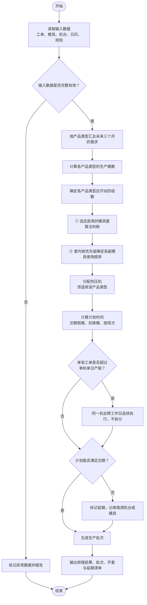

# 热压排程算法说明

## 一、项目背景

### 1.1 企业概况

本项目服务的是一家生产麻将牌及各类异形牌产品的制造企业。企业产品品类与规格众多，涵盖三角牌、多米诺骨牌、香蕉牌、字母牌等，均属标准化的小尺寸成型产品。企业日常同时承接大量客户订单，各订单在数量、牌型组合与交付时间上差异较大，生产组织具有典型的多品种、大批量特征。

### 1.2 生产组织方式

企业的生产由四道工序串联完成。第一道是热压，将粉料压制成牌坯；第二道是进桶，也称滚筒，将牌坯装入桶中滚磨，使其表面圆润；第三道是摆牌，由人工将牌按牌型摆放到板子上；第四道是点漆，为牌上色。四道工序顺序固定，前一道的产出是后一道的投入，任何一道出现停滞，都会沿工序向后逐级传导，影响最终交付。

### 1.3 信息系统与数据来源

企业的订单与工艺数据由金蝶 K3 系统管理。K3 在完成物料需求运算后，已将销售订单按工序拆分为一张张独立的生产工单，APS 系统从 K3 读取这些工单，并按现场规则安排生产。因此 APS 不承担工艺规划职责，既不重新拆分工单，也不依据物料清单补造工序，只对已经拆分好的工单进行排程。

### 1.4 热压环节的地位

热压是四道工序中的第一道，也是整条生产链的源头。只有热压产出了牌坯，后续的进桶、摆牌与点漆才有可加工的对象。热压环节的排程质量直接决定后续工序能否顺畅衔接，一旦热压计划出现偏差，会沿工序向后逐级放大。基于这一考虑，系统建设从热压排程入手。

### 1.5 现状与问题

当前热压排产依赖计划员的经验与手工表格，随着订单规模增长，若干问题逐渐显现。

- 其一，单张销售订单往往可展开出近百张工序工单，整体规模达到上万张，人工难以在可接受的时间内完成排布。
- 其二，模具的组合方式较为复杂，一副模具可同时产出多种牌型，人工难以准确判断一次生产能够覆盖多少张工单，也难以判断某个产品类型应当开动几组设备。
- 其三，交期风险往往到临近交付时才被发现，缺少提前预警的手段。
- 其四，不同计划员的排布结果差异较大，且难以说明优劣，排产经验无法沉淀。

因此需要一套能够自动计算、结果稳定且可解释的排程算法，将排产从依赖个人经验转为依赖明确的规则。

### 1.6 约束条件会持续调整

需要特别说明的是，上述资源与规则并非固定不变。设备数量、模具套数、每班产能、换模时间与提前天数等参数都可能随现场情况调整，而参数一经调整，原有的计划便不再成立，必须重新计算。

因此算法应当支持在任意时点以当前参数重新执行一次完整的排程计算，其正确性只取决于本次输入的参数，不完全依赖历史排程结果，已生产的工单不再纳入计划。

## 二、算法范围

本算法的职责范围限于热压工序的排程。在给定工单、模具、设备与规则的前提下，算法需要确定每张热压工单由哪台热压机、使用哪副模具、在什么时间开始与结束，并识别无法按期完成的工单。进桶、摆牌与点漆三道工序的排程不属于本算法的范围。

尽管下游工序不在本次范围内，热压的产出是下游工序的唯一输入，因此算法需要一并给出每批热压生产完成后的可释放数量与预计释放时间，作为与下游环节的接口。该部分只作输出，不参与本算法的排程决策。

算法只处理排程本身所需的输入，不承担生产报工相关职责。现场按重量称重、按公斤报工以及由此产生的数量换算，属于报工环节的功能，不纳入本算法。热压排程所需的模数由工单数量与模具的产出配比直接计算得出，无需额外的换算参数。

以下内容不属于本算法范围：

- 不重新生成或拆分 ERP 工单；
- 不进行物料需求计算与工艺规划；
- 不实现进桶、摆牌、点漆的排程；
- 不包含报工、品质抽检、成本核算等业务功能；
- 不提供用户界面；
- 不对接 ERP 数据库；
- 不使用人工智能、机器学习或深度学习等方法。

本算法属于确定性的规则计算。

## 三、算法输入

算法需要以下六类数据，均以结构化表格形式提供，具体文件格式与字段命名由双方在开发启动时共同确定。

### 3.1 待排产的热压工单清单

数据范围至少覆盖未来三个月的销售订单与生产工单（月数也是变量之一）。每张工单包含工单号、所属销售订单号、产品类型、数量与计量单位、客户交期以及当前状态。

状态用于区分未开始、在制、已完成与已取消：已经完成生产并报工完毕的工单以及已取消的工单不再纳入排程，在制工单只对其剩余数量排布。

热压工单的数据规模通常为上万条，一个销售订单大致能对应几十条至几百条生产工单，每个工单对应的半成品物料数量大致是几千到几万不等。

### 3.2 产品类型

产品类型是将企业上万种物料归并而成的三十个左右的业务大类，例如三角牌、多米诺骨牌、香蕉牌、字母牌等，是后续所有计算的归口维度。每个产品类型可能对应 ERP 中的一个或多个产品大类编号，该对应关系用于把 ERP 工单归入相应的产品类型。

### 3.3 模具资料

这是热压排程的核心约束。模具按产品类型分别维护，一个产品类型下可维护若干套模具，每套模具可包含若干副模具，由此形成两级结构，算法需要在两级上分别作出决定。

**第一级：选用哪一套模具。** 一个产品类型通常配有多套模具，具体启用哪一套需要由算法判断，而不是由某个固定字段直接指定；判断的依据包括该产品类型的需求规模、需要开动的组数以及各套模具的占用情况。模具的套数决定了该产品类型最多能同时开动几组设备，因此当需求规模超出单套模具的承担能力时，算法需要同时启用多套模具。

**第二级：套内各副模具的使用顺序。** 同一套模具内的每副模具都带有一个优先级字段，数值越小越优先使用，算法据此决定先上哪一副、后上哪一副。

每副模具需要记录四项内容：

1. **模具类型**：分为单点模具与多点模具，单点模具一次只产出一个牌型，多点模具一次可同时产出多个牌型；
2. **牌型**：即该副模具所覆盖的牌型集合；
3. **产出配比**：即每种牌型在该副模具上的数量；
4. **优先级**：即上述第二级所依据的使用顺序。

### 3.4 热压机清单

需要记录三项内容：

1. 热压机的数量；
2. 每台设备的每班产能（以模为单位）；
3. 该设备适用的产品类型。

适用产品类型是机台与模具之间的关联依据：一台热压机被指定适用某个产品类型，即表示它可以承担该产品类型下的全部模具，无需再逐副指定模具。

### 3.5 工作日历

用于确定每天可以安排的生产班次。日历只需记录两类信息：

1. **当天安排几个班**：由于各工序的产能均以班为单位给出，日历不必记录具体的上下班时刻与休息时段，只需标明当天是一个班还是两个班（现场实际为十二小时两班倒）；
2. **节假日安排**：即哪些日期放假、哪些日期正常生产。

按此口径，某一天的可生产能力等于当天的班次数乘以机台的每班产能。

### 3.6 规则参数

包含三项：

1. **分组方式**：两台热压机为一组，每组使用一套模具；由于一名人员操作两台热压机，人员不单独作为排程资源参与计算。
2. **前置偏移天数**：即热压计划需在交货日期之前完成的天数，该天数为配置项，当前取值为十五天。
3. **换模时间**：即更换模具所占用的时长，需计入机台占用。

## 四、算法输出

算法需要产出五类结果，同样以结构化表格形式给出。

### 4.1 热压排程结果

算法的核心输出，每张工单一条记录，包含工单号、分配的热压机、使用的模具、所属生产批次、计划开始日期、计划结束日期、是否延期以及延期天数。计划时间以生产日为单位，必要时可细化到当天的第几班。

### 4.2 批次划分结果

由于一副多点模具可同时产出多种牌型，同一时段内多张工单可能由同一次生产完成。算法需给出批次的编号、所用模具与机台、包含的工单清单、每张工单的投入量以及批次的起止时间。

需要说明的是，这里合并的是现场生产批次，ERP 工单本身始终保持独立，既不合并不拆分。

### 4.3 订单齐套与延期清单

对于能够按期完成的订单，给出预计完成日期；对于无法按期完成的订单与工单，给出应交日期、预计完成日期、延期天数、造成瓶颈的机台或模具以及原因说明。

原因应当具体到环节，例如某产品类型的可用模具数量不足，或某台设备产能不足，而非笼统描述。

### 4.4 可释放数量与预计释放时间

即每批热压生产完成后可交付下游工序的数量及对应时间，供后续工序排程使用。

### 4.5 排程理由

对每一张工单，算法应能说明其被安排在某台设备与某个时间的依据，包括选择该机台的原因、该时间窗口受什么条件约束、若干工单被归入同一批次的原因，以及在关键输入发生变化时结果会如何随之变化。

该输出可采用结构化字段或自然语言说明的形式，目的是使计划人员能够理解并验证排程结果。

## 五、排程主逻辑

排程以客户交期为锚点，采用倒推方式确定各工单的计划时间窗口。热压计划需要在交货日期之前完成，提前的天数由配置项给出，当前取值为十五天；该天数表示计划日期上的差值，并非物料的冷却等待时间，也不是设备的运行时长。

对于每张工单，先据此推算出热压计划完成的目标日期，再结合该工单所需的生产模数、所分配机台的每班产能与工作日历的班次安排，反推其计划开始的生产日与班次。

在确定具体资源之前，算法先按产品类型汇总待排产的需求总量，计算每个产品类型的产出，并据此判断该产品类型应当开动几组设备最为合适。两台热压机为一组，每组使用一套模具，这是热压作业的基本单位。组数受两方面制约：一方面取决于该产品类型的需求规模与机台产能，另一方面受制于可用模具的套数，因为模具套数决定了该产品类型最多能同时开动几组。

### 5.1 模具选用的两级逻辑

模具的选用分为两级，这一点需要特别说明，以免与「优先级」混淆。

**第一级是选定启用的模具套。** 一个产品类型通常配有多套模具，启用哪一套不由固定字段指定，而由算法判断，判断依据是该产品类型的需求规模、需要开动的组数以及各套模具的占用情况。当需求规模超出单套模具的承担能力时，算法需要同时启用多套模具；模具的套数正是该产品类型最多能同时开动几组设备的上限。

**第二级是在选定的模具套内部确定各副模具的使用顺序。** 每副模具带有优先级字段，数值越小越优先使用；算法先用优先级最高的模具覆盖尽可能多的工单，覆盖不完的部分再依次使用同一套内的后续模具，一套内的模具用尽后，再回到第一级启用下一套。

### 5.2 多点模具与批次

多点模具一次成型可产出若干种牌型，每种牌型的产出数量由产出配比给出，因此一次生产可以同时推进对应的若干张工单。

- 例如一副模具同时产出两种牌型，配合两台热压机，则可同时安排四张工单；
- 若开动两组即四台热压机，且该产品类型的模具可拆为两副，则可同时安排八张工单。

单点模具一次只对应一张工单。

### 5.3 资源约束

机台与模具之间存在适配限制。热压机只能使用其适用产品类型范围内的模具，不得跨产品类型安排。同一套模具在同一时刻只能被一组使用，同一台热压机在同一时刻也只能执行一项任务，任何两项任务的时间区间不得重叠。热压按完整模具组织生产，不存在部分装模的情形。更换模具所需的换模时间必须计入计划，占用相应机台。

### 5.4 时间安排

排程只能安排在工作日历标记为生产日的日期上，当天可用的班次数决定了能够完成的模数；非生产日不安排生产。由于产能以班为单位，计划时间按班次累加即可，无需细分到具体的上下班时刻。

当单张工单的工作量超过一台设备一天的班产能时，算法不拆分该工单，而是由同一台设备跨多个生产日连续执行，预计完成时间相应顺延。

### 5.5 已发生事实与延期处理

对于已经发生的事实，算法不重新安排。已经完成生产并报工完毕的工单与已取消的工单不再纳入排程，在制工单只对其剩余数量与当前时点继续排布。

当产能确实不足以满足全部交期时，算法不做勉强的拼凑，而是给出在现有约束下最早可行的计划，明确标记延期工单，并指出瓶颈所在的机台或模具，供计划人员判断是增加设备、增补模具还是调整交期。

### 5.6 全量重算

算法以一次完整计算为单位，输入确定则输出确定。当设备数量、模具套数、每班产能、换模时间或提前天数等约束条件发生调整时，以调整后的参数重新执行一次完整计算即可得到新的计划，无需在上一次结果的基础上做局部修补。

## 六、必须满足的约束

排程结果必须同时满足以下约束，这些约束是验收的硬性条件，任何一项不满足即视为结果无效。

- **时间维度**：同一资源的任务区间不得重叠，且所有任务只能安排在日历标记为生产日的日期与当天的班次内。
- **资源维度**：机台只能承担其适用产品类型下的模具，模具在同一时刻只能服务于一组。
- **工艺维度**：必须以完整模具为单位组织生产，换模时间必须计入机台占用。
- **对象维度**：不得拆分 ERP 工单，不得生成或删除工单，且已完成报工与已取消的工单不得纳入排程。

## 七、优化目标与优先级

在满足上述约束的前提下，算法需要在多个目标之间取舍。目标的重要性依次为：

1. **首先保证交期**：以延期订单数最少为首要衡量标准，在延期订单数相同时以总延期天数最少为次；
2. **其次提高设备利用率**：尽量减少设备空闲并使各机台负荷相对均衡；
3. **再次减少换模次数**：使同一台设备尽可能连续加工需要同一副模具的工单；
4. **最后是结果的可解释性与稳定性**：即每个安排都能说明理由，且输入发生小幅变化时结果不应出现剧烈跳变。

当目标之间发生冲突时，应当牺牲设备利用率以保全交期，减少换模同样不应以牺牲交期为代价。

## 八、边界情况处理

算法应当对以下情况给出明确且稳定的行为，不得崩溃，也不得输出错误结果。

- 当某产品类型没有任何可用模具时，相关工单应被标记为无法排产并给出原因，不得静默丢弃。
- 当某张工单找不到任何适配的机台时，同样标记异常并说明原因。
- 当工单数量为零或负数、交期缺失或早于当前日期、产品类型无法与模具或机台建立对应关系时，应将其标记为异常数据并报告，不得擅自以默认值替代。
- 当工作日历未覆盖某一日期时，该日按不生产处理，同时报告日历缺失情况。
- 当输入为空时，输出空结果即可，不应报错。
- 当排程结果导致尾数无法被现有批次覆盖时，应报告该批次异常并交由人工处理，不得擅自跨销售订单合并。
- 当输入规模显著超出预期时，算法应给出性能退化的说明而非直接失败。

统一的要求是，任何异常都必须明确报告，不得静默跳过，也不得编造数据。一份带有异常说明的结果，比一份表面完整但基于猜测的结果更有价值。

## 九、前置条件与验收标准

算法合作方可以假定输入数据字段完整、格式规范，异常数据按上述规则处理。

数据规模方面：

- 热压工单数量为上万条；
- 热压机数量为几十台；
- 产品类型为三十个左右；
- 模具为数百副。

运行方式为离线批处理，每次执行一次完整的排程计算；由于约束条件会随现场情况调整，算法需支持在任意时点以最新参数重新执行全量计算，不依赖上一次的排程结果，也不要求实现增量重排。计划时间粒度为生产日，可按班次细分。运行环境为普通服务器，无图形处理器，无外网访问。算法必须保证可复现，即在相同输入下得到相同输出；若采用随机算法，必须固定随机种子。

算法合作方不应假定设备数量与工单数量固定不变，不应假定所有产品都具备完整的四道工序，不应假定所有设备都能生产所有产品，也不应假定订单一定能够在交期内完成。

验收时：

- 算法输出须满足第六章的全部约束，可由我方提供的校验工具自动检查，要求全部通过；
- 在样例数据集上，延期订单数与总延期天数应达到双方约定的目标；
- 算法应能对任意一张工单说明其安排的依据；
- 全量排程应在约定时间内完成；
- 相同输入下的输出应当一致，且输入小幅变化时结果不应剧烈跳变；
- 第八章所列边界情况均应有明确且稳定的行为。

## 十、待明确事项

以下事项需在开发启动前由双方共同确认：

- 正式模具清单，包括模具套划分、各副模具的产出配比与优先级，以及各产品类型的模具套数；
- 模具套的启用规则，即一个产品类型配有多套模具时，按什么依据选择启用哪一套；
- 各台热压机的适用产品类型与每班产能取值；
- 换模时间的具体数值；
- 前置偏移天数的最终取值；
- 全量排程允许的时间上限与延期指标的评测口径；
- 算法交付的语言、接口形式与部署方式。

## 附录：热压排程算法流程图

### 流程图说明

1. **产能单位「模」**：热压机压一次为一模，机台产能以「模/班」计。
2. **组**：两台热压机为一组，每组使用一套模具。
3. **产出配比**：一副模具一次成型产出的各牌型数量。
4. **模具套**：一个产品类型可配多套模具，启用哪一套由算法判断。
5. **优先级**：同一套模具内各副模具的使用顺序，数值小者先用。
6. **班次**：日历只标明当天排几个班（现场为 12 小时两班倒）以及是否放假。
7. **换模时间**：更换模具所占用的时长，计入机台占用。
