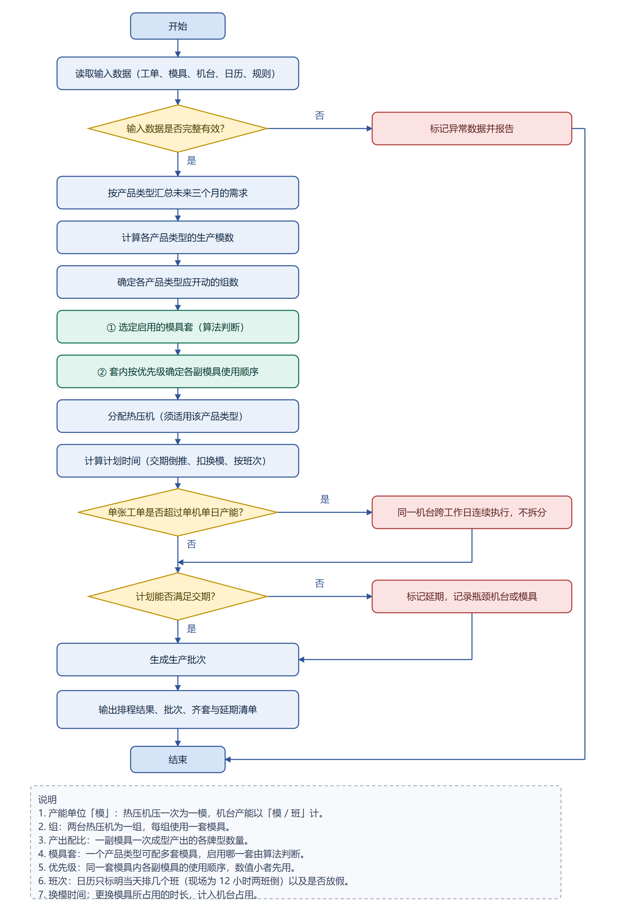

# 热压排程项目背景与已知知识

> 版本：v1.0（2026-10-22）
> 用途：把**项目背景、现场口径、真实工单数据**收在一处，作为设计、开发与验收的共同底稿。
> 需求原文以《热压排程算法说明.md》为准；算法细节以《热压排程算法设计.md》为准；
> 本文只做事实汇总与差异标注，不替代上述两份文档。

**材料来源**

| # | 材料 | 性质 |
| --- | --- | --- |
| 1 | 《热压排程算法说明.md》 | 客户需求原文，含流程图与验收标准 |
| 2 | `工单.xls` | 金蝶 K3 导出的《生产任务单序时簿》，2026-10-22 09:10，全厂 43,967 行 |
| 3 | 2026-10-22 现场口径确认 | 38 台热压机、19 人、一人两台、同时开 19 台、只做热压、前置 15 天等 |
| 4 | `93a9783af469d9b1d00ea6852e15b6d2.png` | 热压排程算法流程图（需求说明附录） |

**口径优先级**：客户书面需求 > 现场确认 > 真实数据 > 设计稿/参考实现。
发生冲突时按此顺序裁决，并在 §6 留痕。

---

## 1. 项目背景

### 1.1 企业概况

企业生产麻将牌及各类异形牌产品，品类与规格众多，涵盖三角牌、多米诺骨牌、香蕉牌、
字母牌等标准化小尺寸成型产品。日常同时承接大量客户订单，各订单在数量、牌型组合与
交付时间上差异较大，生产组织呈典型的多品种、大批量特征。

### 1.2 生产组织方式

生产由四道工序串联完成，顺序固定，前一道产出是后一道投入：

```
热压（粉料压成牌坯） → 进桶/滚筒（滚磨圆润） → 摆牌（人工按牌型摆放） → 点漆（上色）
```

任何一道停滞都会沿工序向后逐级传导，影响最终交付。**本项目只排第一道热压**；
进桶、摆牌、点漆不在范围内，但热压的产出是下游的唯一输入，所以输出里要带
「可释放数量与预计释放时间」作为工序间接口。

### 1.3 信息系统与数据来源

订单与工艺数据由**金蝶 K3** 管理。K3 完成物料需求运算后，已把销售订单按工序拆成
一张张独立的生产工单；APS 从 K3 读取这些工单并按现场规则排程。因此：

- APS **不重新拆分工单**，也不依据 BOM 补造工序；
- APS 只对已经拆好的热压工单排程；
- 不直接连接 ERP 数据库，输入是结构化表格（当前为 K3 导出的 `.xls`）。

### 1.4 热压环节的地位

热压是四道工序的源头：只有热压产出牌坯，后续进桶、摆牌、点漆才有加工对象。
热压计划一旦偏差，会沿工序向后放大，所以系统建设从热压排程入手。

### 1.5 现状与问题

当前热压排产依赖计划员经验与手工表格，随着订单规模增长，问题集中在四处：

1. 单张销售订单常展开出近百张工序工单，整体规模上万张，人工难以在可接受时间内排完；
2. 模具组合复杂（一副多点模具可同时产出多种牌型），人工难以判断一次生产能覆盖多少
   工单、某产品类型该开几组设备；
3. 交期风险往往到临近交付才被发现，缺少提前预警；
4. 不同计划员结果差异大且难以说明优劣，经验无法沉淀。

目标是建立一套**自动计算、结果稳定、可解释**的确定性排程算法，把排产从依赖个人经验
转为依赖明确规则。

### 1.6 约束会持续调整

设备数量、模具套数、每班产能、换模时间、提前天数都可能随现场调整。参数一变，原计划
即不成立，必须**以当前参数重新执行一次完整计算**；正确性只取决于本次输入，不依赖历史
排程结果，已生产工单不再纳入。因此不做增量重排。

### 1.7 官方流程图



图注（需求说明附录原文）：

1. **产能单位「模」**：热压机压一次为一模，机台产能以「模/班」计；
2. **组**：两台热压机为一组，每组使用一套模具；
3. **产出配比**：一副模具一次成型产出的各牌型数量；
4. **模具套**：一个产品类型可配多套模具，启用哪一套由算法判断；
5. **优先级**：同一套模具内各副模具的使用顺序，数值小者先用；
6. **班次**：日历只标明当天排几个班（现场为 12 小时两班倒）以及是否放假；
7. **换模时间**：更换模具所占用的时长，计入机台占用。

> **与现场口径的差异**：流程图按需求原文保留「两台热压机为一组、每组一套模具」。
> 2026-10-22 现场确认 38 台可独立运行，「组」是否仍作为排程单位、还是只作为人员/管理
> 概念，待定（见 §6.2）。

---

## 2. 算法范围与边界

**在范围内**

- 对已拆分的热压工单排程：定机台、定模具、定开始/结束日期与班次；
- 识别无法按期完成的工单，给出延期天数与瓶颈（机台/模具/日历）；
- 输出五类结果：排程结果、批次、订单齐套与延期、可释放数量与时间、排程理由；
- 结果必须满足硬约束（时间、资源、工艺、对象四个维度），可被独立校验器检查。

**不在范围内**

- 不重新生成或拆分 ERP 工单；
- 不做物料需求计算与工艺规划；
- 不排进桶、摆牌、点漆；
- 不做报工、品质抽检、成本核算；
- 不提供用户界面、不对接 ERP 数据库；
- 不使用人工智能、机器学习或深度学习。

算法属于**确定性规则计算**，相同输入必须得到相同输出。

---

## 3. 现场口径（2026-10-22 确认）

### 3.1 已确认事实

| 项 | 值 | 说明 |
| --- | --- | --- |
| 热压机 | **38 台，可独立运行** | 物理设备总数；每台可单独开动，无固定两两成组 |
| 工人 | **19 人** | 热压车间操作人员总数 |
| 操作方式 | **一人两台** | 一名工人看两台机 |
| 同时开动 | **19 台** | 并行上限；是否任意 19 台、跨类型共享待确认 |
| 班次 | 12 小时两班倒 | 需求说明 §3.5；日历只记 1 班/2 班 |
| 前置偏移 | **15 天** | 热压须在交期前完成；需求说明 §3.6、§5 |
| 排程范围 | **只做热压** | 滚牌、摆牌、铜钉等后道不纳入 |
| 机台与模具 | 不同机器换不同模具，部分机器专用 | **完整归属资料尚不齐** |
| 产品类型 | 正式 ERP 大类映射待补 | 现阶段按物料长代码前缀归并，见 §4.7 |

### 3.2 这条口径对算法的影响

1. **并行上限是 19 台，不是 38 台。** 若直接把 38 台放进模型，产能会高估一倍。
   19 台是**跨产品类型共享的全局上限**还是**按类型分配**，尚未确认（见 §6.2）。
   若是全局上限，现有「按类型独立排程」的结构只能保证「每个类型内部不超过自己的
   机台数」，不能保证「所有类型同时不超过 19 台」。38 台可独立运行，也意味着
   **不应再把机台两两固定配对成组**；现有「组 = 2 台共用一套模具」的建模需要废止
   或降为软约束。
2. **人员不单独建模。** 现场给定的是「38 台机器、19 人、一人两台、同时开 19 台」；
   排程只需要「并行机台上限 = 19 台」这一条，不需要再拆一层人工资源。
3. **只做热压。** ERP 里「滚牌 / 摆牌 / 铜钉」工单是热压之后的后道工序，默认剔除。
   实测它们与主工单数量几乎 1:1 成对（5,252/5,436 组逐组相等），若一起排会把热压
   工作量重复计算。
   > **命名差异待确认**：需求说明的四道工序是「热压 / 进桶（滚筒）/ 摆牌 / 点漆」，
   > ERP 出现的是「滚牌 / 摆牌 / 铜钉 / 已点漆」。「滚牌」应对应进桶/滚筒、
   > 「已点漆」应对应点漆；「铜钉」未在需求四工序中单列。当前一并按后道处理，
   > 对应关系需现场确认。
4. **15 天前置。** 目标完成日 = 交期 − 15 天，是日期差值，不是冷却时间。按此口径，
   未来 3 个月有 549 张工单的目标日已经早于计划起点（见 §4.4）。

---

## 4. 真实工单数据

### 4.1 文件与结构

`工单.xls` 是 K3 的**全厂**生产任务单序时簿，不是热压专用导出：

- 单表：`生产任务单序时簿`；
- 43,967 行数据、25 列；
- 覆盖热压、点漆、包装、注塑、丝印/移印、UV、外发等多个车间；
- 热压车间 21,790 行，占 49.6%。

**主要列**

| ERP 列 | 含义 | 本项目的用法 |
| --- | --- | --- |
| 编号 | 工单号 | `work_order_no`，主键 |
| 单据状态 | 下达 / 结案 | 结案视为已完成 |
| 生产车间 | 车间名 | 过滤 `热压车间` |
| BOM编号 | 订单 BOM | 追溯、按订单/套装分组 |
| 物料长代码 | 半成品物料编码 | **牌型** `pattern_code`；前 3/4 段推出产品类型 |
| 销售订单号 | 所属销售订单 | `sales_order_no`；批次不得跨销售订单 |
| 物料名称 | 物料描述 | 识别后道工序（滚牌/摆牌/铜钉） |
| 规格型号 | 颜色、尺寸等 | 辅助识别，暂不参与计算 |
| 批号 | 生产批号 | 辅助追溯，不参与计算 |
| 单位 | 计量单位 | 热压全部为 `pcs` |
| 计划生产数量 | 工单数量 | `qty` |
| 实作数量 | 实际生产数量 | **本导出全部为 0**，不可用 |
| 合格品入库数量 | 已入库数量 | 用于推在制剩余量 |
| 合格数量 | 合格数量 | **本导出全部为 0**，不可用 |
| 计划开工日期 | ERP 计划开工 | 不直接使用；引擎按槽位自行排 |
| 计划完工日期 | ERP 计划完工 | 暂按交期 `due_date` 处理（口径待确认） |
| 执行状态 | 下达 / 结案 / 完全入库 | 与单据状态一起判完成 |
| 计划类别 / BOM类别 | 标准 / 订单BOM | 辅助 |

### 4.2 取数漏斗

按「热压车间 → 剔除后道 → 剔除已完成 → 剔除过期未结 → 保留未来 3 个月」处理：

| 步骤 | 行数 | 说明 |
| --- | ---: | --- |
| 序时簿总行数 | 43,967 | 全厂 |
| 热压车间 | 21,790 | `生产车间 = 热压车间` |
| 剔除后道工单 | 9,701 | 名称以「滚牌 / 摆牌 / 铜钉」结尾 |
| 剔除已完成 | 4,462 | 结案、完全入库、或入库量 ≥ 计划量 |
| 剔除过期未结 | 6,916 | 计划完工日 < 2026-10-22 |
| **未来 3 个月入排程** | **711** | 2026-10-22 至 2027-01-22 |

> 「过期未结」是取数策略，不是数据错误。这 6,916 张的状态仍是「下达」，但计划完工日
> 落在 2026-05 至 2026-09；可能是实际已完成但未结案，也可能是真实积压，**需现场确认**。
> 若要看全部积压，用 `--include-overdue` 保留。

### 4.3 未来 3 个月的需求结构

711 张主工单 = 18 个销售订单、6 个产品类型、437 个牌型、**9,192,833 pcs**。

| 产品类型 | 工单 | 牌型 | 销售订单 | 数量(pcs) |
| --- | ---: | ---: | ---: | ---: |
| 2.2.07（4807 骨牌） | 56 | 28 | 2 | 47,684 |
| 2.2.08（5007 骨牌） | 56 | 28 | 2 | 1,068,544 |
| 2.2.11（5208 骨牌） | 91 | 91 | 1 | 298,116 |
| 2.2.16（三角牌） | 280 | 168 | 5 | 2,079,280 |
| 2.2.25（香蕉牌） | 188 | 83 | 7 | 5,501,383 |
| 2.2.39（香蕉游戏骨牌） | 40 | 39 | 1 | 197,826 |

**到期日分布**

| 交期 | 工单 | 数量(pcs) |
| --- | ---: | ---: |
| 2026-10-23 | 168 | 1,712,368 |
| 2026-10-28 | 26 | 2,830,464 |
| 2026-10-30 | 28 | 915,720 |
| 2026-11-01 | 56 | 1,179,480 |
| 2026-11-03 | 271 | 939,061 |
| 2026-11-08 | 56 | 47,684 |
| 2026-11-12 | 28 | 152,824 |
| 2026-11-20 | 52 | 943,488 |
| 2026-12-18 | 26 | 471,744 |

交期高度集中在 5 个日期（10/23–11/03，共 549 张），其中 10/28 的 26 张就有 283 万 pcs，
是产能压力最大的单批。

### 4.4 交期与 15 天前置

按「目标完成日 = 计划完工日 − 15 天」计算：

- **549 张 / 7,577,093 pcs 的目标完成日已经早于 2026-10-22**；
- 只有 162 张（11/08 之后到期的）目标日还在未来。

两种解释只能二选一：

| 解释 | 含义 | 应采取的动作 |
| --- | --- | --- |
| A. ERP「计划完工日期」= **客户交期** | 549 张是真实的逾期积压 | 保留 15 天前置，排程会集中报延期；这是现状 |
| B. ERP「计划完工日期」= **热压完成日** | 再减 15 天是重复扣减 | 前置偏移应设为 0，直接以该日期为目标 |

**这一条尚未最终确认**，是当前最影响结果的口径问题（见 §6.1）。

### 4.5 产能口径

按 19 台并发、每天 2 班、窗口 58 天（10/22–12/18）：

| 项 | 数值 |
| --- | ---: |
| 机台班 | 58 × 2 × 19 = **2,204** |
| 平均每机台班需产出 | **4,171 pcs** |
| 若配比 10 pcs/模 | 417 模/班 |
| 若配比 20 pcs/模 | 209 模/班 |
| 若配比 50 pcs/模 | 83 模/班 |
| 若配比 100 pcs/模 | 42 模/班 |

这个量级不算离谱，但**能不能达成完全取决于模具配比**；在正式模具清单到位前不能下结论。

**历史入库不能直接当产能基线**：热压主工单的「合格品入库数量」按计划完工月汇总为
5 月 1.32 亿、6 月 2,728 万、7 月 2,129 万、8 月 568 万、9 月几乎为 0。
5 月可能包含跨期累计、8–9 月则明显是入库未录完，不能据此标定「模/班」。

### 4.6 数据质量

| 项 | 事实 | 处理 |
| --- | --- | --- |
| 实作数量 / 合格数量 | 全厂热压 21,790 行**全部为 0** | 不用；改用「合格品入库数量」 |
| 合格品入库数量 | 7,063 行非 0 | 推在制剩余量：`remaining = qty − inbound` |
| 计划开工 > 计划完工 | 全量 3,764 行（17.3%），多为 −2 天；窗口内 0 行 | 不影响 3 个月窗口；全量排程时需按 V03 报异常 |
| 后道工单与主工单数量 | 5,436 组「主 + 后道」，其中 5,252 组两边数量完全相等 | 证明后道是同一批牌的后道工序，不是额外产量 |
| 工单号重复 | 热压车间 0 条 | — |
| 数量 ≤ 0 / 交期缺失 | 热压车间 0 条 | — |
| 物料代码跨销售订单复用 | 3,789 个热压物料代码中 2,146 个跨订单复用，最多 69 个订单 | 牌型必须按物料代码识别，不能按订单识别 |
| 销售订单 / BOM | 482 个 BOM、300 个销售订单；**没有 BOM 跨销售订单**（0 个），2 个销售订单跨多个 BOM | 与「批次不跨销售订单」的假设一致 |

### 4.7 字段映射（ERP → 逻辑模型）

| 逻辑字段 | 取自 | 口径 |
| --- | --- | --- |
| `work_order_no` | 编号 | 主键 |
| `sales_order_no` | 销售订单号 | 批次边界 |
| `product_type_code` | 物料长代码前缀 | `2.2.xx` 取前 3 段；`H.2.2.xx` 取前 4 段 |
| `pattern_code` | 物料长代码 | 同一代码即同一牌型，跨订单复用 |
| `material_code` | 物料长代码 | 与牌型同值，留作 A1-b 物料反查 |
| `qty` | 计划生产数量 | 单位 pcs；用 `Decimal(str(x))`，不经 float |
| `uom` | 单位 | 全部 `pcs`，不做换算 |
| `due_date` | 计划完工日期 | 暂按交期；口径见 §4.4 |
| `status` | 单据状态 + 执行状态 + 入库量 | 见下 |
| `remaining_qty` | 计划生产数量 − 合格品入库数量 | 仅 `IN_PROGRESS` 使用 |

**状态判定**

```
结案 / 完全入库 / 入库量 ≥ 计划量  → COMPLETED（不排）
0 < 入库量 < 计划量               → IN_PROGRESS，remaining = qty − inbound
其余                              → NOT_STARTED
```

**产品类型归并**

按物料长代码前缀归并，全量 21,790 行得到 **24 个产品类型前缀**（见附录 A），
与需求说明「三十个左右」接近；3 个月窗口只涉及其中 6 个。正式的
「ERP 产品大类 → 产品类型」映射仍未提供，当前前缀法是临时口径。

### 4.8 数据规模与需求说明的对照

| 需求说明的假设 | 真实数据 | 结论 |
| --- | --- | --- |
| 热压工单上万条 | 21,790 条 | 一致 |
| 一个销售订单几十至几百张工单 | 单 BOM 热压工单 1–214 张；单销售订单的热压主工单 1–107 张 | 量级一致（热压只是整张销售订单的一部分工序） |
| 产品类型约 30 个 | 代码前缀 24 个 | 接近 |
| 热压机几十台 | 38 台（同时开 19 台） | 一致，但并发是 19 |
| 模具数百副 | **未提供** | 缺口 |
| 每班产能（模/班） | **未提供** | 缺口 |

---

## 5. 已知业务规则（需求说明要点）

### 5.1 资源与组织

- **组**：两台热压机为一组，每组使用一套模具；一名工人操作两台，人员不单独建模。
- **模具套**：一个产品类型可配多套；套数决定该类型最多同时开几组。
- **模具**：每副有类型（单点/多点）、覆盖牌型、产出配比、优先级（数值小者先用）。
- **机台**：每台有每班产能（模/班）与适用产品类型；只能承担适用类型下的模具。
- **日历**：每天 0/1/2 班，另有节假日；不生产日不排。

### 5.2 两级模具选用

1. **选套**：不由固定字段指定，按需求规模、需开组数、各套占用情况判断；需求超出单套
   能力时同时启用多套。
2. **套内选副**：按优先级从高到低覆盖工单；一套用尽再启用下一套。

### 5.3 多点模具与批次

- 多点模具一次成型产出多种牌型，配比给出每种牌型的数量；
- 一次生产可同时推进多张工单；例如一副双牌型模具配两台机，可同时安排 4 张工单；
- 合并的是**现场生产批次**，ERP 工单本身不合并、不拆分。

### 5.4 硬约束

- **时间**：同一资源任务区间不重叠，只能排在日历生产日与班次内；
- **资源**：机台只做适用类型；同一套模具同一时刻只服务一组；同一台机同一时刻只做一项；
- **工艺**：以完整模具为单位生产，不部分装模；换模时间计入机台占用；
- **对象**：不拆分/生成/删除工单；已完成报工与已取消工单不排。

### 5.5 时间安排

- 以交期为锚点倒推目标完成日，再按模数、机台产能、日历班次反推开始日/班次；
- 单张工单超过一台机单日产能时，**不拆分**，由同一台机跨生产日连续执行；
- 以班次为最小时间单位，不需细化到上下班时刻。

### 5.6 优化目标（按优先级）

1. **交期**：先最小化延期订单数，再最小化总延期天数；
2. **设备利用率**：减少空闲、各机台负荷均衡；
3. **换模次数**：同一台机尽量连续用同一副模具；
4. **可解释性与稳定性**：每张工单能说明依据，输入小幅变化不剧烈跳变。

冲突时：牺牲利用率保交期；减少换模不得以牺牲交期为代价。

### 5.7 边界情况

需求说明第八章要求对以下情形给出明确、稳定、不崩溃的行为：

- 产品类型无可用模具 → 标记无法排产，不静默丢弃；
- 工单无适配机台 → 标记异常并说明；
- 数量 ≤ 0、交期缺失或早于当前日期、产品类型无法对应 → 标记异常数据，不擅自用默认值；
- 日历未覆盖某日 → 按不生产处理，并报告日历缺失；
- 输入为空 → 输出空结果，不报错；
- 尾数无法被现有批次覆盖 → 报告批次异常交人工，不跨销售订单合并；
- 规模显著超出预期 → 给出性能退化说明，不直接失败。

统一原则：**任何异常都必须明确报告，不得静默跳过，也不得编造数据。**

### 5.8 验收标准

- 第六章硬约束全部通过，可由独立校验工具自动检查；
- 样例数据集上延期订单数与总延期天数达到双方约定目标；
- 任意工单可说明安排依据；
- 全量排程在约定时间内完成；
- 相同输入输出一致，小幅变化不剧烈跳变；
- 第八章边界情况均有明确稳定行为。

---

## 6. 口径冲突与未决事项

### 6.1 交期口径（最优先）

ERP 只有「计划完工日期」，没有独立的「客户交期」。而需求说明的前置 15 天是相对
**客户交期**定义的。因此存在两种解释（§4.4）：

- 若 ERP 日期 = 客户交期 → 15 天前置成立，549 张已逾期；
- 若 ERP 日期 = 热压完成日 → 前置应设 0，否则重复扣减。

**这是当前唯一会直接改变延期结论的口径，需现场确认。**

### 6.2 19 台并发与按类型独立排程

- 现场：**38 台可独立运行**、19 人、一人两台，**同时开 19 台**（是否任意 19 台、
  跨类型共享待确认）；
- 参考实现：按产品类型独立排程，并把机台两两固定配对成组；这两点都与「独立机台 +
  全局 19 台」不符；
- 数值上的巧合：若按 38 台、`group_size=2` 排，会分出 19 组，看起来接近 19 台；但
  组内 `parallel` 取 2，实际会放成 38 台并发；若只给 19 台，`max_groups=floor(19/2)=9`，
  又丢掉一台。**数值看似接近，机制是错的。**

可选方案：

| 方案 | 做法 | 代价 |
| --- | --- | --- |
| A. 全局 19 机位 | 38 台独立机台共享 19 个并发名额 | 结构改动大，但符合现场 |
| B. 19 组 × 组内并行 1 台 | 固定两两配对，组内同时只开 1 台 | 实现小；要求固定配对，与「独立运行」冲突 |
| C. 静态配额 | 19 台按需求比例分给各产品类型 | 实现小；配额人工定，可能次优 |
| D. 先按 38 台排 | 暂不建模并发上限 | 产能高估一倍，结果不可用于现场 |

### 6.3 机台与模具归属

现场口径是「不同机器换不同模具，但某些热压机针对某些不同的模具，背景资料还不全」。
这句话同时包含两层信息：

1. 机台**可以换模**，因此可能在不同时段做不同产品类型；
2. 部分机台**专用**于特定模具/类型。

现有模型假设「一台机在计划期内只服务一个产品类型」（A2）。在拿到 38 台机的归属表之前，
无法判断应按 A2 排、还是改成跨类型共享。**这是第二个结构项。**

### 6.4 产品类型映射

需求说明说产品类型是「ERP 产品大类归并成的三十个左右业务大类」。当前只能用物料代码
前缀临时归并出 24 个；正式的 ERP 大类 → 产品类型映射表仍未提供。

### 6.5 过期未结工单

6,916 张计划完工日在 **2026-05-05 至 2026-10-20**、状态仍为「下达」的工单，是真实积压
还是未结案的历史数据，需现场确认。它决定 3 个月窗口是否要包含这部分需求。按月分布：
5 月 1,197、6 月 515、7 月 1,168、8 月 1,618、9 月 1,869、10 月 1–20 日 549。

### 6.6 待补数据清单

| # | 数据 | 影响 | 状态 |
| --- | --- | --- | --- |
| 1 | 正式模具清单：套、模具、覆盖牌型、配比、优先级 | 决定模数与模具套启用，影响面最大 | **缺** |
| 2 | 每台机每班产能（模/班） | 决定组数与延期指标 | **缺** |
| 3 | 38 台机 → 产品类型/模具归属 | 决定 A2 是否成立、19 台如何分配 | **部分**（仅知有专用机，无清单） |
| 4 | 工作日历：节假日、每周生产天数、1/2 班 | 决定可用槽位 | **缺** |
| 5 | 换模时间数值与单位 | 单一参数中最敏感 | **缺** |
| 6 | 交期口径：ERP 日期是客户交期还是热压完成日 | 决定前置 15 天是否成立 | **待确认** |
| 7 | 过期未结工单是否纳入 | 决定窗口需求规模 | **待确认** |
| 8 | 延期指标目标值与全量时间上限 | 验收口径 | **待约定** |
| 9 | 交付语言、接口形式、部署方式 | 交付形态 | **未定** |

---

## 7. 已落地工具与复现方式

| 工具 | 作用 |
| --- | --- |
| `prototype/ingest/erp.py` | ERP 序时簿 → `WorkOrder`：车间过滤、状态/剩余量、产品类型与牌型推导、后道剔除、时间窗、V01–V03 |
| `prototype/tests/real_data.py` | 数据体检；可导出标准化 `work_order.csv`；含 15 天前置与 19 台并发核算 |
| `prototype/tests/ingest_erp.py` | 取数层回归 31/31 |

复现：

```bash
python prototype/tests/real_data.py 工单.xls --plan-start 2026-10-22 --months 3 \
    --csv data/real-2026-10-22
python prototype/tests/ingest_erp.py
```

当前产物（`data/` 已 gitignore，含客户信息，不入库）：

- `data/real-2026-10-22/work_order.csv`：711 行标准化热压工单；
- `data/real-2026-10-22/intake.txt`：取数漏斗、需求结构、产能核算的完整输出。

---

## 8. 材料索引

| 材料 | 作用 |
| --- | --- |
| 《热压排程算法说明.md》 | 客户需求原文；验收以它为准 |
| 《热压排程资源数据口径缺口清单.md》 | 还缺哪些资源/数据/口径，按 P0–P2 可勾选 |
| 《热压排程算法自身问题清单.md》 | 组模型、全局 19 台、A2、目标函数、校验器与测试的改造点 |
| 《热压排程算法设计.md》 | 我方设计稿 v0.2，待评审 |
| 《热压排程算法落地计划.md》 | 分阶段实施顺序、阻塞关系、数据到位情况 |
| 《热压排程参数敏感性分析.md》 | 待定参数的取值影响 |
| 《热压排程结构性假设影响评估.md》 | A1/A2/A4 不成立时的改动量 |
| 《热压排程输入输出字段字典.md》 | 字段类型、必填、枚举、示例行 |
| 《热压排程代码审核记录.md》 | 全量审核发现的 10 条缺陷与修复 |
| `93a9783af469d9b1d00ea6852e15b6d2.png` | 官方流程图 |
| `工单.xls` | K3 序时簿原始数据（外部文件，不入库） |

---

## 附录 A：热压车间产品类型前缀全表

按物料长代码前缀归并，全量 21,790 行共 24 个前缀；加粗为未来 3 个月窗口涉及的 6 个。

| 产品类型 | 工单数 | 代表物料 |
| --- | ---: | --- |
| 2.2.11 | 5,599 | 5208 白色无钉点数骨牌（已抛光） |
| **2.2.16** | 3,832 | RAL9010 48MM / 25MM 三角牌（高档抛光） |
| **2.2.25** | 3,739 | 香蕉牌字母 A、B、C… |
| H.2.2.99 | 2,577 | 30MM 象牙色麻将 1饼… |
| **2.2.08** | 1,528 | 5007 白色无钉彩点点数骨牌 |
| 2.2.29 | 864 | 小拉米牌（已抛光） |
| 2.2.18 | 758 | 大拉米牌（已抛光） |
| H.2.2.30 | 746 | 30MM 白底蓝背美国麻将（已点漆） |
| **2.2.39** | 520 | 香蕉游戏骨牌 a… |
| 2.2.19 | 440 | 5209 白色无钉点数/数字骨牌 |
| 2.2.15 | 388 | 5412 象牙色无钉点数骨牌 |
| 2.2.99 | 225 | 六边形游戏集骨牌 |
| 2.2.41 | 216 | 30mm 白底单色麻将 166 张 |
| **2.2.07** | 169 | 4807 白色/象牙色无钉点数骨牌 |
| H.2.2.18 | 48 | 白色彩点数字方块 |
| 2.2.21 | 34 | 4007 白色无钉骨牌 |
| 2.2.40 | 28 | 月亮骨牌 |
| H.2.2.21 | 28 | 黑色/米色象棋（帅、炮、马…） |
| H.3.1 | 15 | 30MM 黄色背面美国麻将 + JOKER |
| 2.2.17 | 13 | 方骰子 |
| 2.2.12 | 10 | 5210 白色无钉骨牌 |
| 2.2.22 | 8 | 19mm 紫色/绿色数字骨牌 |
| 2.2.09 | 4 | 5008 白色无钉骨牌白板 |
| H.2.2.17 | 1 | 21×21mm 圆角数字彩点骰子 |

> 该表是**数据事实**，不是正式的「产品类型」定义。正式定义需 ERP 产品大类映射表。
